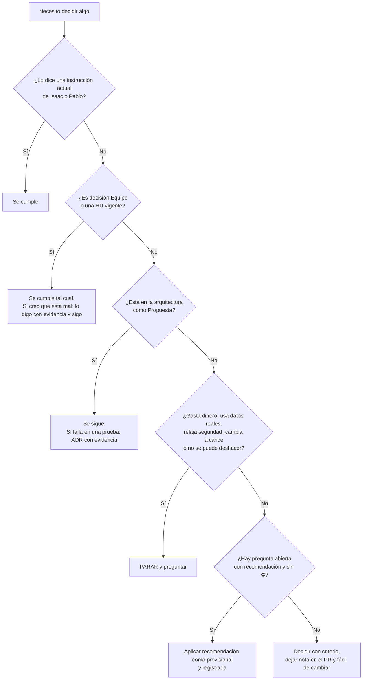

# Reglas de decisión para construir SWEVEH

> **Para qué sirve este documento:** que cualquier agente (o persona) pueda decidir solo, sin volver a preguntar lo que ya está decidido, y que sepa exactamente cuándo **sí** debe parar y preguntar a Isaac o a Pablo.
> **Última actualización:** 1-nov-2026. Si cambia una regla, se edita aquí y se anota en el registro de cambios al final.

---

## 1. Quién manda: orden de precedencia

Cuando dos documentos o instrucciones se contradicen, gana el de **arriba**. Nunca se resuelve un conflicto en silencio: se aplica el de mayor rango, se anota el conflicto como pregunta nueva en `docs/07-preguntas-abiertas.md` (formato Q-xx) y se sigue trabajando.

| Rango | Fuente | Ejemplo |
|---|---|---|
| 1 | **Instrucción explícita y actual de Isaac o Pablo** en la conversación | "Cambia X por Y" |
| 2 | **Decisiones del equipo** (etiqueta `Equipo`): tabla DE-xx en `docs/01-producto-y-contexto.md` y ADR-01 a ADR-07 en `docs/06-arquitectura.md` | Go + Supabase, monolito modular, sin VIN |
| 3 | **Historias de usuario vigentes** (`docs/04-historias-de-usuario.md`) y los **requisitos** RF/RNF/CA (`docs/03-mvp-requisitos.md`) | HU-27 cotización |
| 4 | **Arquitectura propuesta** (`docs/06-arquitectura.md`, ADR-08 en adelante, etiqueta `Propuesta`) | Fly.io, ES256 de 10 min |
| 5 | **Resto de propuestas** de los documentos del MVP (guion, taller ficticio, valores iniciales) | Servitaller El Pistón |
| 6 | **Criterio del agente** | Nombre de una función |

**Corrección conocida entre rangos 2 y 3:** el documento del MVP (30-oct) decía Spring Boot, VIN opcional y "motos fuera". El equipo lo cambió: **Go**, **sin VIN**, **motor con cilindraje y turbo**, **motos dentro**. Gana siempre lo más reciente del equipo (ver sección 11).

---

## 2. Etiquetas de certeza (úsenlas en código comentado, PR y documentos)

| Etiqueta | Significa | Qué hace el agente |
|---|---|---|
| `Equipo` | Lo decidieron Isaac y Pablo | Se cumple. Cambiarlo requiere su permiso (R-02) |
| `Propuesta` | Diseño recomendado, aún no aceptado | Se sigue por defecto; se puede cambiar con ADR (R-13) |
| `Oficial` | Fuente del dueño del dato (Meta, SIC, RUNT…) | Se confía, se cita la URL |
| `Tercero` | Blog, prensa, proveedor | Se usa con cautela y se marca |
| `Inferencia` | Razonamiento sin prueba | **Se prueba antes de depender de ello** (ej.: RLS + `SET LOCAL` con el pooler) |
| `Sin dato` | Se buscó o no existe el dato | **No se inventa.** Se registra y se avanza con la recomendación |
| `Ficticio` | Inventado para la demo | Nunca se mezcla con datos reales |

**Regla de oro heredada del equipo (29-oct):** nada de suposiciones sin respaldo. Toda afirmación factual nueva lleva fuente (URL) o se marca `Sin dato`.

---

## 3. Matriz de autonomía: qué puede hacer el agente solo

### 3.1 Decide solo, sin avisar

- Nombres de funciones, variables, archivos y paquetes internos (siguiendo `docs/08-glosario-y-convenciones.md`).
- Detalles de interfaz dentro de lo que dice una HU (disposición, textos de error, estados vacíos), respetando español de Colombia.
- Refactors locales que no cambian comportamiento ni contrato público.
- Librerías menores de la lista aprobada (`docs/06-arquitectura.md`, sección 4.2 y 11.2) o equivalentes de la misma categoría con licencia permisiva y mantenimiento activo.
- Pruebas adicionales (siempre bienvenidas).
- Valores iniciales marcados "a calibrar" en la arquitectura (timeouts, tamaño de pool, TTL), dejándolos en **configuración**, no clavados en código.

### 3.2 Decide y deja registro (nota en el PR; ADR si cambia la arquitectura)

- Agregar una dependencia **no listada** (justificar: qué problema, alternativas, licencia, mantenimiento, Snyk limpio).
- Forma exacta de tablas, índices y migraciones dentro del esquema propuesto.
- Aplicar la **recomendación** de una pregunta abierta que **no** esté marcada ⛔ (R-04).
- Partir una HU en dos si pasa de 3 días de trabajo (R-03).
- Cambiar un valor de la arquitectura `Propuesta` cuando una prueba demuestre que no sirve (se escribe ADR con la evidencia).

### 3.3 PARA y pregunta a Isaac o Pablo antes de continuar

1. Cambiar, contradecir o "mejorar" algo con etiqueta `Equipo`.
2. **Cambiar el alcance:** crear, borrar, fusionar o cambiar la prioridad de una HU; agregar una función que no está en ninguna HU.
3. Cualquier cosa que **gaste dinero** o cree cuentas: planes de pago, dominios, proveedores de IA, SMS, números de WhatsApp reales, suscripciones.
4. **Preguntas abiertas marcadas ⛔** (AQ-01, AQ-02, AQ-04, AQ-10, AQ-12) cuando bloquean lo que se está construyendo.
5. Usar **datos reales** de talleres o clientes, o conectar un número de WhatsApp real.
6. **Relajar** una regla de seguridad, aislamiento, privacidad o auditoría (R-05, R-06, R-10).
7. **Desplegar a producción**, hacer push forzado, reescribir historia de `main`, borrar datos o migraciones destructivas en cualquier entorno compartido.
8. Publicar o enviar algo fuera del repositorio (correos, mensajes, artefactos públicos, posts).
9. Una tarea cuya interpretación razonable tenga **dos lecturas con consecuencias distintas** y no se pueda deshacer.

> Si la decisión se puede deshacer fácilmente después de que alguien la vea, **actúa, di qué hiciste y qué lectura elegiste**. Si no se puede deshacer, pregunta.

### 3.4 NUNCA (sin excepción)

- Secretos, tokens, claves o datos personales reales en el repositorio, en logs, en capturas o en fixtures.
- Saltarse, desactivar o "silenciar" pruebas, SonarQube, Snyk, gitleaks o reglas de arquitectura para poner el pipeline en verde. Un falso positivo se ignora **solo** con justificación escrita y fecha de vencimiento.
- Guardar tokens de sesión en `localStorage`/`sessionStorage`.
- Quitar `FORCE ROW LEVEL SECURITY`, usar un rol con `BYPASSRLS` en la API, o leer una tabla de otro módulo.
- Que la IA envíe al cliente un texto redactado por ella sin que el dueño pulse **Enviar** (RF-18), o que cite un precio que no está en la lista del taller (RF-17).
- Inventar un dato (precio, norma, cifra, fuente). Si no se sabe: `Sin dato`.
- Guardar el **VIN** (decisión del equipo) o usar placas/celulares reales en datos de ejemplo.
- Mezclar `main` con trabajo sin revisar: el agente **no** hace merge ni despliega a producción por su cuenta.

---

## 4. Reglas de trabajo (R-01 a R-17)

### R-01 · Una rebanada vertical a la vez
Se construye **una historia (o parte de una) de punta a punta**: migración → dominio → caso de uso → adaptador HTTP → pantalla → pruebas → documentación. No se construyen capas enteras "para después". La primera rebanada obligatoria es la del Sprint 0 (`docs/05-orden-de-construccion.md`).

### R-02 · Las decisiones del equipo no se tocan
Si el agente cree que una decisión `Equipo` es mala, lo **dice con evidencia** (en el PR o en la conversación) pero sigue cumpliéndola hasta que Isaac o Pablo cambien la instrucción. Proponer ≠ cambiar.

### R-03 · "Lista para construir" y "Terminada"
**Una HU está lista para construir si:** tiene rol, qué y para qué; tiene criterios Dado/Cuando/Entonces; sus dependencias están terminadas; las preguntas abiertas que la afectan tienen respuesta o se acepta la recomendación; y cabe en 1 a 3 días de trabajo de una persona (si no, se parte).

**Una HU está terminada si:**
1. Todos sus criterios de aceptación pasan (prueba automática donde se pueda).
2. Respeta el aislamiento entre talleres: la consulta lleva `taller_id` y existe una prueba que demuestra que otro taller no ve el dato (CA-10).
3. Si cambia estado: escribe **auditoría** y publica **evento en la misma transacción** (secciones 8.6 y 10.4 de la arquitectura).
4. Si recibe entrada externa (webhook, POST con efectos): es **idempotente**.
5. Tiene permiso RBAC definido y probado (permiso `recurso:acción`).
6. No registra datos prohibidos en logs (celular completo, tokens, contenido de mensajes).
7. Contrato OpenAPI actualizado y cliente TypeScript regenerado.
8. Pasa el pipeline completo (lint, pruebas con `-race`, SonarQube, Snyk, gitleaks, govulncheck) y el quality gate.
9. Si toca WhatsApp: probada con el número de prueba, dentro y fuera de la ventana de 24 h.
10. Si toca la IA: corre contra el conjunto de mensajes de prueba sin precios inventados ni acciones fuera de lista.
11. Textos en español de Colombia, pesos sin decimales, fechas en `America/Bogota`.
12. El documento de estado (`docs/09-estado-de-construccion.md`) y, si aplica, la HU, quedan actualizados **en el mismo PR**.

### R-04 · Cómo tratar una pregunta abierta
1. Busca la pregunta en `docs/07-preguntas-abiertas.md`.
2. **Si ya tiene respuesta** (columna "Estado = Decidida"): aplícala.
3. **Si no está marcada ⛔ y tiene recomendación:** aplica la recomendación como **decisión provisional**, regístrala en la tabla "Decisiones provisionales" con fecha y la HU afectada, y construye el código para que sea **fácil de cambiar** (detrás de una interfaz, una bandera de configuración o una columna, no esparcida por el código).
4. **Si está marcada ⛔ o no tiene recomendación:** para y pregunta (3.3).
5. Si descubres una pregunta nueva, agrégala con el siguiente número Q-xx/AQ-xx, con su recomendación.

### R-05 · Seguridad no negociable
Cookies `HttpOnly` + `Secure` + `SameSite=Strict` con prefijos `__Host-`/`__Secure-`; JWT ES256 de 10 min + refresh opaco rotativo con detección de reutilización; CSRF (encabezado personalizado + `Origin`/`Sec-Fetch-Site`); RBAC por permiso verificado en el **servidor** (el front solo oculta botones); verificación de propiedad del objeto (anti-IDOR); SQL siempre parametrizado (sqlc); validación contra OpenAPI en el borde; límites de tasa; webhook de WhatsApp con firma HMAC SHA-256 en tiempo constante; secretos solo en el gestor de la plataforma; imagen sin root; CSP estricta. Detalle en secciones 6 y 7 de la arquitectura.

### R-06 · Aislamiento entre talleres (multi-tenant)
Toda tabla de negocio lleva `taller_id`, `ENABLE` + `FORCE ROW LEVEL SECURITY` y política `taller_id = current_setting('app.taller_id')`. El `taller_id` **sale de la sesión**, nunca del cuerpo de la petición. La API usa un rol sin `BYPASSRLS` ni DDL. Cada PR que agregue una tabla agrega su **prueba de aislamiento con dos talleres**. Si RLS + `SET LOCAL` no funciona con el pooler, se aplica el plan B de la arquitectura (R-A3) **después de preguntar** (3.3 punto 6).

### R-07 · Concurrencia: cuál mecanismo usar
| Caso | Mecanismo |
|---|---|
| Edición de órdenes, cotizaciones, artículos | **Optimista**: columna `version`, `If-Match`/`ETag`, 409 si no coincide |
| Descuento de inventario | `UPDATE … SET cantidad = cantidad - $n WHERE cantidad >= $n` + movimiento en el libro, misma transacción |
| Números de orden por taller | Contador con `SELECT … FOR UPDATE` |
| Varias filas | Bloqueos en **orden ascendente de ID** |
| Entrada externa (webhook, POST) | **Idempotencia**: `wamid` único, `Idempotency-Key` |
| Worker/cola | `FOR UPDATE SKIP LOCKED` + estado del mensaje |
| Cron | `pg_try_advisory_lock` para una sola ejecución |
| Invariantes entre filas | `SERIALIZABLE` + reintento ante `40001` y `40P01` (máx. 3, con *jitter*) |

Ninguna HU que toque estos casos está terminada sin su **prueba de concurrencia** con N goroutines (arquitectura 8.8).

### R-08 · Reglas del agente de IA
- **La IA propone, el código decide, el humano aprueba.** La salida del modelo es JSON validado contra un esquema; lo que no valida se descarta y pasa a humano (RF-17).
- Solo precios, horarios y servicios que estén cargados por el taller. Si falta el precio: "el taller te confirma el valor".
- AU-05 ("¿ya está mi carro?") **no redacta texto libre**: llena una plantilla con datos reales de la base. La IA solo clasifica la intención.
- El agente es un **actor con rol propio y permisos mínimos**: crea borradores; no aprueba, no ajusta inventario, no cambia precios.
- Todo mensaje o dato originado en la IA guarda su origen y las ediciones del dueño (RF-19).
- Proveedor detrás de una interfaz propia; registrar tokens y **costo por conversación** (RNF-06, RNF-14). Tope de pasos, tokens y dinero por taller/mes.
- El texto del cliente es **dato**, nunca instrucción: se delimita y no se concatena al prompt del sistema.
- El agente solo responde sobre el taller (política de Meta, RNF-08): nunca como asistente general.
- Conjunto de pruebas adversariales ("ignora tus instrucciones…") obligatorio en CI antes de dar por terminadas las HU del agente.
- Si la IA o WhatsApp fallan: la orden y el historial siguen funcionando y el borrador pasa a "Lo contesto yo" (RNF-13).

### R-09 · Reglas de WhatsApp
- Demo con **número de prueba de Meta** (`Propuesta`, D-01). El cliente escribe primero para estar en la ventana de 24 h.
- Canal detrás de la interfaz `CanalMensajeria` (RNF-07): pasar al número real del taller no debe tocar el resto.
- Webhook: leer el cuerpo crudo, validar `X-Hub-Signature-256`, responder 200 rápido, procesar asíncrono, deduplicar por `wamid`.
- Botones de respuesta: máximo 3, 20 caracteres por título.
- Antes del primer mensaje a un número, **autorización de datos** registrada (RF-22). Sin autorización, el mensaje no pasa por la IA y lo atiende el dueño a mano (Q-09).
- Plantillas aprobadas por Meta para mensajes fuera de la ventana; textos editables por el dueño pueden tardar en aprobarse (Q-17, `Sin dato`).

### R-10 · Datos personales (Ley 1581 de 2012)
Autorización previa, expresa e informada y con prueba (texto, versión, canal, fecha, hora); el silencio no es autorización (Decreto 1377 art. 7). Minimización: no se piden datos que no se usan. Taller = responsable, SWEVEH = encargado (contrato de transmisión, AQ-10). Datos sintéticos en desarrollo y pruebas. Retención y borrado según política (tarea diaria auditada). Cualquier tema legal concreto se marca `Sin dato` y se consulta con un abogado: **este repositorio no es asesoría legal.**

### R-11 · Calidad mínima
Cobertura de código **nuevo** ≥ 80 % en dominio y aplicación; `go test -race ./...`; `golangci-lint` (con `depguard`) y test de arquitectura sin violaciones; `tsc --noEmit` y ESLint en el front; Vitest para lógica; Playwright para el recorrido de la demo. Código generado (`sqlc`, `oapi-codegen`) y `cmd/` se excluyen de cobertura con justificación.

### R-12 · Cambios de alcance y de documentos
- El **alcance** vive en `docs/04-historias-de-usuario.md` y `docs/data/historias.json`. Cambiarlo requiere instrucción del equipo (3.3 punto 2). Se registra: id, qué cambió, fecha y quién lo pidió, en el registro de cambios de este documento y en el `Historial` de la HU.
- Los números de HU **no se reutilizan ni se renumeran**. Una HU cancelada se queda marcada como cancelada.
- La **documentación se actualiza en el mismo PR** que el código que la cambia. Un PR que cambia comportamiento sin tocar docs se rechaza.

### R-13 · Cuándo escribir un ADR
Se escribe un ADR (`docs/adr/NNNN-titulo.md`, plantilla en `docs/adr/0000-plantilla.md`) cuando una decisión: (a) es difícil de revertir, (b) afecta a más de un módulo, (c) cambia una decisión `Propuesta` de la arquitectura, o (d) elige entre alternativas con costo real. Contiene contexto, decisión, alternativas descartadas, consecuencias y evidencia. Los ADR-01 a ADR-21 ya existen en el documento de arquitectura (sección 14.1).

### R-14 · Git, ramas y PR
- Ramas `feat/HU-27-aprobar-cotizacion`, `fix/…`, `docs/…`, `chore/…`. Commits en español, imperativo, con el id de la HU: `HU-27: aprobar cotización por botón de WhatsApp`.
- PR **pequeños** (orientativo: < 400 líneas cambiadas) y con la descripción: qué HU/criterios cubre, cómo se probó, riesgos, docs actualizados.
- `main` protegida: PR obligatorio, revisión de **la otra persona** (Isaac revisa a Pablo y viceversa), verificaciones obligatorias en verde, historial lineal.
- El agente abre PR y **no hace merge**. No despliega a producción (3.3 punto 7).

### R-15 · Honestidad ante todo
Reporta lo que falló con su salida real. Si saltaste un paso, dilo. Si no pudiste probar algo, dilo. Si algo quedó "funciona en mi máquina", no está terminado. No declares "terminado" sin haber corrido las pruebas.

### R-16 · Convenciones de idioma y formato
Ver `docs/08-glosario-y-convenciones.md`: UI y mensajes en español de Colombia; moneda COP **sin decimales**; fechas en `America/Bogota` y almacenadas en UTC; celular colombiano de 10 dígitos (guardar en E.164 `+57…`); placa en mayúsculas sin espacios.

### R-17 · Abrir y cerrar cada sesión de trabajo
**Al abrir:** lee `CLAUDE.md`, `docs/09-estado-de-construccion.md` y la HU que vas a construir con sus dependencias y preguntas abiertas. Confirma el tramo (T0…T7) y no saltes dependencias.
**Al cerrar:** actualiza el estado de las HU tocadas, anota decisiones provisionales y preguntas nuevas, deja el pipeline en verde o explica por qué no, y escribe en la bitácora qué sigue.

---

## 5. Árbol de decisión rápido

## 6. Cuándo una HU puede saltarse el orden

Nunca por conveniencia. El orden lo dan las **dependencias** escritas en cada HU y los tramos T0…T7. Lo que no está en el camino de la demo (53 de 101 HU) **sí** se construye, pero **después** y sin romper las diez escenas.

## 7. Qué hacer si el pipeline se pone rojo

1. Reproduce el fallo localmente; no empujes "arreglos a ciegas".
2. Corrige la causa. **Nunca** desactives la prueba ni bajes el umbral.
3. Si el fallo es de una herramienta externa (límite de plan de Snyk/Sonar), no lo ocultes: avisa (3.3 punto 3) y prioriza SCA en PR → Container en `main` → Code en `main`.
4. Si es un falso positivo, ignóralo con justificación y fecha de vencimiento en el mismo PR.

## 8. Qué hacer si algo contradice un documento

- Documento vs. código existente: gana la **intención del documento** si es `Equipo`/HU; si es `Propuesta`, gana lo que demuestre la prueba. En ambos casos se corrige el que quede mal.
- Documento vs. documento: aplica la precedencia de la sección 1 y registra la contradicción como Q-xx.
- Fuente externa que cambió (Meta, Supabase, Snyk): vuelve a leer la documentación **vigente**, cita la URL y marca el cambio.

## 9. Política de dependencias y licencias

Preferir la biblioteca estándar de Go; librerías con licencia permisiva (MIT, BSD, Apache-2.0) y mantenimiento activo; ninguna con vulnerabilidades altas o críticas alcanzables; versiones fijadas (`go.sum`, `package-lock.json`). Toda dependencia nueva con **runtime** (no solo desarrollo) se justifica en el PR.

## 10. Reglas específicas del dominio taller

- Un cliente se identifica por **celular** (10 dígitos); un vehículo por **placa**. Sin duplicados exactos (RF-04, RF-05).
- **Sin VIN.** Todo vehículo (carro o moto) tiene **motor** con `cilindraje_cc` (entero, siempre en cc) y `turbo` (sí/no). "Motor pendiente" se permite hasta pasar la orden a **Recibido** (Q-23).
- **7 estados** de orden: Por recibir → Recibido → En diagnóstico → Esperando aprobación → En reparación → Listo → Entregado, más **Cancelada** fuera del flujo (Q-04, Q-05). Cada cambio guarda usuario y hora y es inmutable.
- Placas: carro `ABC123`; moto `ABC12D` y el formato antiguo `ABC12`, más "placa especial", hasta confirmar con RUNT/Mintransporte (Q-01).
- El mecánico **no** ve costos ni KPIs de dinero (RF-21). El costo de IA y el medidor de mensajes son del **Administrador del ERP**, no del taller (HU-74, Q-24).
- El ERP **no** recuerda técnico-mecánica (HU-50 cancelada). AU-09 (garantía) está en duda (Q-25).
- Auto-envío de la IA (HU-67): solo plantillas con datos, nunca texto redactado por la IA (propuesta Q-27).
- No es un ERP ni compite con los grandes ERP: no se construye contabilidad, factura electrónica DIAN, nómina ni marketplace (se integrará Siigo/Alegra después).

## 11. Cambios del equipo ya aplicados (no revertir)

| Fecha | Cambio | Dónde aplica |
|---|---|---|
| 31-oct-2026 | Motos dentro del MVP, además de carros | HU con moto (24), placa moto, checklist moto |
| 1-nov-2026 | VIN fuera del registro de vehículos | HU-10, HU-11, modelo de datos |
| 1-nov-2026 | Todo vehículo tiene motor con cilindraje y turbo | HU-11, HU-20, modelo de datos |
| 1-nov-2026 | HU-74 (medidor de mensajes y costo de IA) es del Administrador del ERP | E09, Q-24 |
| 1-nov-2026 | HU-50 cancelada (el ERP no recuerda técnico-mecánica) | E06, Q-25 |
| 1-nov-2026 | Todas las HU vigentes pasan a Must (101) | Backlog completo |
| 1-nov-2026 | Backend Go, Supabase, React + TS + Vite + Tailwind, JWT, RBAC, cookies seguras, GitHub Actions + SonarQube + Snyk | `docs/06-arquitectura.md` |
| 1-nov-2026 | Arquitectura: monolito modular con capas hexagonales | `docs/06-arquitectura.md` |

## 12. Registro de cambios de este documento

| Fecha | Cambio | Quién lo pidió |
|---|---|---|
| 1-nov-2026 | Versión inicial | Isaac / Pablo |
