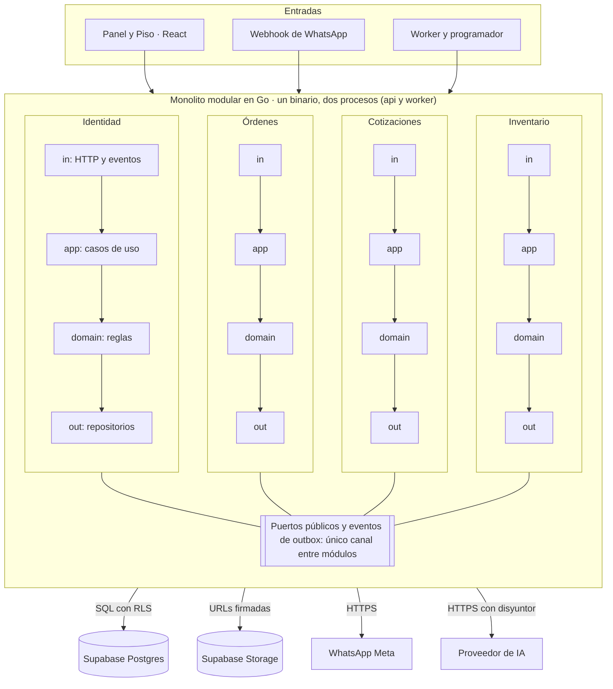
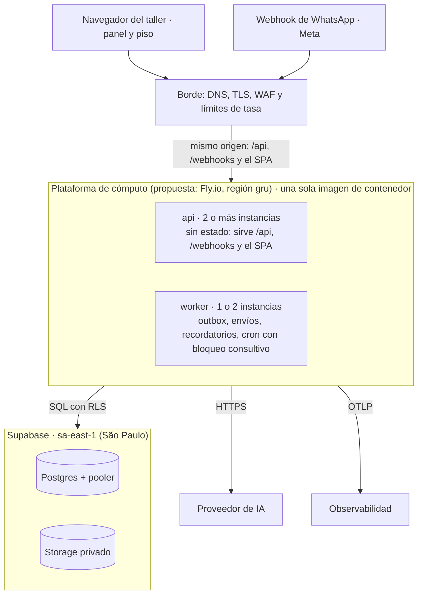

# Arquitectura SWEVEH

> Copia de trabajo del Claude Doc "Arquitectura SWEVEH" (1-nov-2026) — original: https://claude.ai/artifact/LUQHmSChKP37B22XQAAgXU
> Los diagramas del original se incluyen aquí como Mermaid. Etiquetas: **Equipo** = lo pidieron Isaac y Pablo; **Propuesta** = recomendación a confirmar; **Inferencia** = por probar; **Sin dato** = no verificado.
> Los ADR-01 a ADR-07 son decisiones del equipo (no se cambian sin permiso). Del ADR-08 en adelante son propuestas que se pueden modificar con un ADR (`docs/adr/`).


1-nov-2026 · Isaac y Pablo

## Resumen

SWEVEH arranca como **un solo servicio en Go**, partido en módulos con capas hexagonales, sobre **Postgres de Supabase**, con una interfaz **React + TypeScript + Vite + Tailwind** servida desde el mismo origen. La sesión va en cookies seguras con JWT, el acceso se controla con RBAC por taller, y la seguridad, la auditoría, la observabilidad y la resiliencia se construyen desde el primer día, no al final. Todo es propuesta de diseño: nada está construido.

**Lo que el equipo ya decidió (1-nov-2026)**

| Tema | Decisión del equipo |
| --- | --- |
| Estilo | Monolito modular, con capas internas hexagonales |
| Backend | Go |
| Base de datos | Supabase (Postgres) |
| Frontend | React con TypeScript, Vite y Tailwind CSS |
| Sesión y acceso | JWT, RBAC y cookies seguras |
| Calidad transversal | Seguridad, observabilidad, auditoría, resiliencia y control de concurrencia |
| Entrega | GitHub Actions con SonarQube y Snyk |

**Lo que propongo para cerrar los huecos** (detalle y alternativas en las secciones siguientes)

1. **Un solo binario con dos roles de ejecución** (`api` y `worker`): se escalan por separado sin partir el sistema en servicios.
2. **Supabase solo como Postgres y almacenamiento privado.** No se usa su Data API ni su sistema de login: el backend en Go es la única puerta de entrada.
3. **Aislamiento entre talleres en dos capas:** filtro obligatorio en el código y políticas RLS en la base, con un rol de conexión que no puede saltárselas.
4. **Cookies `HttpOnly` con prefijo `__Host-` en un mismo origen**, token de acceso de 10 minutos y refresco rotativo con detección de reuso.
5. **Cola de trabajos dentro de Postgres** (patrón outbox), sin Redis ni broker al inicio.
6. **OpenTelemetry** para trazas y métricas, y una **bitácora de auditoría aparte** de los logs, que solo admite inserciones.
7. **Despliegue en São Paulo** (misma región que Supabase `sa-east-1`) y un pipeline con puertas de calidad y seguridad antes de cada despliegue.

**Lo que este documento reemplaza.** El documento del MVP (30-oct) proponía Spring Boot y React. Con Go y Supabase, esa línea de la sección de datos queda sin efecto; el resto del MVP, sus historias y sus criterios de aceptación siguen vigentes. Ver [Historias de usuario SWEVEH](https://claude.ai/artifact/XENupGcm9WgWp9aKvb4rYy).

**Los tres riesgos que más pesan**

- **Ubicación de los datos.** La Circular Externa 008 de 2017 de la SIC no lista a Brasil entre los países con nivel adecuado de protección y sí lista a Estados Unidos. Dónde viva la base y a dónde viaje el texto hacia la IA cambia el análisis legal, y hoy no está resuelto (AQ-03).
- **Alcance frente a tiempo.** El stack nuevo, la seguridad y la entrega continua son trabajo adicional a las 101 historias, y el proyecto no tiene fecha de demo (Q-26 de las historias).
- **Costo de las herramientas.** El plan gratuito de SonarQube Cloud cubre repositorios privados hasta 50.000 líneas, y el de Snyk limita las pruebas en privados sin publicar el número en la página consultada (AQ-05).

## Contexto y restricciones

La arquitectura se mide contra los requisitos no funcionales del MVP y las historias, no contra gustos de herramienta. Estas son las restricciones que más la condicionan.

| Restricción | De dónde sale | Qué obliga en la arquitectura |
| --- | --- | --- |
| Ningún taller ve datos de otro | RNF-09, CA-10, HU-79 | Aislamiento por taller en código y en la base, con prueba automática |
| Celular primero, a 400 px y con una mano | RNF-02, CA-11 | Interfaz responsive, instalable, cámara desde el navegador |
| Borrador en menos de 30 s; aviso de cambio de estado en menos de 1 min | RNF-03, RNF-04 | Procesamiento asíncrono con cola, y métricas de latencia de extremo a extremo |
| IA acotada e intercambiable, una llamada por mensaje | RNF-05, RNF-06 | Puerto `LLMProvider`, salida validada por código, costo registrado por llamada |
| Canal intercambiable (número de prueba a número del taller) | RNF-07 | Puerto `MessagingChannel` |
| La IA solo habla del taller | RNF-08 | Instrucciones fijas del sistema y validación de salida |
| Seguridad básica: HTTPS, códigos con expiración, fotos privadas con enlaces temporales, token de Meta solo en el servidor | RNF-10 | Almacenamiento privado, secretos fuera del frontend |
| Datos personales con autorización previa; IA o servidores fuera de Colombia son transmisión | RNF-11, Ley 1581 | Registro de autorización, análisis de ubicación de datos (AQ-03) |
| Si la IA o WhatsApp fallan, la orden y el historial siguen | RNF-13 | Degradación controlada y aislamiento de fallos (ver Resiliencia) |
| Costo de IA y mensajes medible por taller desde el día uno | RNF-14, HU-74 | Registro de uso por taller y vista del administrador |
| Todo cambio deja rastro | HU-88 | Módulo de auditoría |
| Equipo de dos personas | Proyecto | Un solo despliegue, pocas piezas que operar, nada de infraestructura propia |

**Escala de diseño.** El proyecto no tiene datos de volumen real: ni mensajes al día por taller, ni cuántos talleres habrá. Lo único escrito son talleres de 1 a 5 personas, un piloto con 3 a 5 talleres y los límites de Meta de 10 talleres nuevos por semana antes de verificar y 200 después. Propongo diseñar para decenas de talleres y miles de órdenes al mes, con un camino claro para crecer, y no para millones. Es una suposición de trabajo, no una medida.

**Atributos de calidad, en orden de prioridad (propuesta).**

1. Seguridad y aislamiento de datos.
2. Confiabilidad de la demo y del piloto.
3. Simplicidad operativa para dos personas.
4. Costo bajo y visible.
5. Rendimiento, que no es el cuello de botella con este volumen.

## Arquitectura lógica




Las flechas hacia abajo muestran quién habla con quién. La banda resaltada es la regla central: ningún módulo lee las tablas de otro.

Es un monolito modular: **un despliegue, una base de datos y muchos módulos con fronteras que el linter y las pruebas hacen cumplir**. Con dos personas y un solo flujo de datos, esto da transacciones simples (el cambio de estado, el descuento de inventario y el evento que dispara el aviso caben en una sola transacción) y deja abierta la puerta a separar un módulo más adelante.

### Capas hexagonales dentro de cada módulo

| Capa | Qué contiene | Puede depender de | No puede depender de |
| --- | --- | --- | --- |
| `domain` | Entidades, objetos de valor, reglas y máquina de estados (por ejemplo, las transiciones de la orden) | Solo la biblioteca estándar y el núcleo compartido | Base de datos, HTTP, WhatsApp, IA |
| `app` | Casos de uso ("aprobar cotización") y los **puertos**: interfaces que el caso de uso necesita | `domain` | Cualquier adaptador |
| `adapters/in` | HTTP, webhook de WhatsApp, trabajos programados | `app` | `adapters/out` directamente |
| `adapters/out` | Repositorios Postgres, cliente de WhatsApp, cliente de IA, almacenamiento de fotos | `app` (implementa sus puertos) | Otros módulos |

La regla es una sola: las dependencias apuntan hacia adentro. El dominio no sabe que existe Postgres, WhatsApp ni un modelo de IA, y por eso se prueba sin ninguno de los tres.

### Módulos

| Módulo | Responsabilidad | Épicas de las historias |
| --- | --- | --- |
| `identity` | Registro, código por celular, sesiones, usuarios, roles y permisos | E01, E11 |
| `tenant` | Taller, configuración, horario, plan y datos del administrador | E01, E11 |
| `directory` | Clientes, vehículos (carro o moto) y su motor | E02 |
| `workorders` | Órdenes, estados, checklist, fotos, garantía | E03 |
| `quotes` | Cotización y aprobación del cliente | E04 |
| `inventory` | Repuestos, movimientos, compras y bodegas | E05 |
| `messaging` | Canal de WhatsApp: recepción, envío, conversaciones, ventana de 24 h | E06, E07 |
| `automations` | Catálogo AU-01 a AU-09, interruptores, ejecuciones | E06 |
| `assistant` | Agente de WhatsApp (extracción y borrador) y asistente del dueño | E07, E10 |
| `inbox` | Bandeja "Por revisar" y medición de ediciones | E08 |
| `analytics` | Seis KPIs del dueño | E09 |
| `usage` | Consumo de mensajes y costo de IA por taller, solo para el administrador | E09, E14 |
| `consent` | Autorización de datos (Ley 1581) y derechos del titular | E12 |
| `audit` | Bitácora de acciones, solo inserción | E12 |
| `migration` | Importación de plantillas, fotos y cuadernos | E13 |
| `shared` | Núcleo compartido: identificadores, dinero en pesos enteros, errores, contexto del taller, reloj | Todas |

Son 15 módulos y un núcleo. No hace falta construirlos todos como paquetes grandes: varios (`tenant`, `usage`, `consent`) empiezan con pocas decenas de líneas.

### Reglas de convivencia

1. **Un módulo solo importa la API pública de otro** (un paquete `api` con interfaces y objetos de datos), nunca su dominio, sus repositorios ni sus tablas.
2. **Lecturas entre módulos:** llamada directa a esa API, dentro del mismo proceso.
3. **Efectos entre módulos:** eventos de dominio guardados en la misma transacción que el cambio (patrón *outbox*) y consumidos por un trabajador. Ejemplo: `workorders` publica `OrdenCambioDeEstado` y `automations` decide si hay que avisar al cliente.
4. **Cada módulo es dueño de sus tablas** (un esquema de Postgres por módulo) y ningún otro módulo hace consultas sobre ellas.
5. **Las reglas se hacen cumplir con herramientas, no con disciplina:** la carpeta `internal/` de Go impide importaciones desde fuera, un linter de dependencias (por ejemplo `depguard`, dentro de `golangci-lint`) prohibe los cruces ilegales, y una prueba de arquitectura falla si alguien los introduce. Es una propuesta; `depguard` y la prueba concreta quedan por elegir.

### Puertos principales

| Puerto | Quién lo usa | Primer adaptador | Requisito |
| --- | --- | --- | --- |
| `MessagingChannel` | `messaging` | API de WhatsApp Cloud con el número de prueba de Meta | RNF-07 |
| `LLMProvider` (`assistant/app.Interpreter`, ADR-0026) | `assistant` | Reglas locales; OpenRouter para la demo; el definitivo sale de D-08 | RNF-05, RNF-06 |
| `OTPSender` | `identity` | Por decidir (AQ-01) | HU-01 |
| `ObjectStorage` | `workorders`, `migration` | Supabase Storage, bucket privado | RNF-10 |
| `TxManager` y `Outbox` | Todos | Postgres con pgx | RNF-13 |
| `Clock` | Todos | Reloj del sistema (y uno falso en pruebas) | Pruebas de ventana de 24 h y de vencimientos |

### Un caso de punta a punta: el cliente aprueba la cotización

1. Meta llama al webhook. `messaging` verifica la firma, guarda el evento crudo con el id del mensaje y responde 200.
2. Un trabajador toma el evento. Si el id del mensaje ya existe, lo descarta: es un reintento de Meta.
3. `quotes` abre una transacción, bloquea la orden, comprueba que sigue "Esperando aprobación" y la pasa a "En reparación".
4. En esa misma transacción `inventory` descuenta los repuestos, `audit` registra el cambio y se inserta el evento en la cola de salida.
5. `automations` consume el evento y, si la tarjeta está encendida, `messaging` envía "Listo, empezamos" por el puerto `MessagingChannel`.

Si cualquier paso de la transacción falla, no queda nada a medias. Si el envío falla después, la orden ya está bien y el aviso se reintenta.

### Lo que esta arquitectura no es

No son microservicios, no usa *event sourcing* ni separa lectura y escritura en modelos distintos. Cada una de esas piezas resuelve problemas que SWEVEH todavía no tiene.

## 4. Backend en Go: repositorio, librerías, API y trabajos en segundo plano

**Estado: PROPUESTA** (el equipo decidió Go; las librerías concretas son nuestra recomendación y se validan en el Sprint 0).

### 4.1 Estructura del repositorio (un solo binario, varios módulos)

```
sweveh/
├── cmd/
│   ├── api/            # main: HTTP + wiring (composition root)
│   └── worker/         # main: outbox, jobs, recordatorios (mismo código, otro proceso)
├── internal/
│   ├── platform/       # transversal: config, db (pgx pool), logging, otel, httpx, authn, clock
│   ├── identity/       # M-identidad: usuarios, OTP, sesiones, roles
│   │   ├── domain/     # entidades y reglas puras (sin imports de infraestructura)
│   │   ├── app/        # casos de uso (handlers de comandos y consultas)
│   │   ├── ports/      # interfaces in (casos de uso) y out (repositorios, relojes, notificadores)
│   │   └── adapters/
│   │       ├── in/http/        # handlers chi + DTO
│   │       └── out/postgres/   # sqlc + repositorios
│   ├── tenancy/ vehicles/ customers/ orders/ quotes/ inventory/ ...   # misma forma por módulo
│   └── shared/         # solo tipos neutros: IDs, Money, errores de dominio, eventos
├── api/openapi.yaml    # contrato (fuente de verdad)
├── db/migrations/      # migraciones SQL versionadas (una carpeta por esquema/módulo)
├── db/queries/         # consultas para sqlc
└── deploy/             # Dockerfile, fly.toml / service.yaml, scripts
```

**Reglas de dependencia (se hacen cumplir en CI, no por buena voluntad):**

1. `domain` no importa nada fuera de `shared` y de la librería estándar.
2. `app` importa `domain` y `ports`; nunca `adapters`.
3. `adapters` implementan `ports`; nunca se importan entre módulos.
4. Un módulo solo habla con otro por (a) su **puerto público** (interfaz Go en `ports/`) o (b) **eventos** vía outbox. Nunca lee las tablas del otro.
5. `internal/` impide que código externo importe el módulo, y `depguard` (golangci-lint) más un test de arquitectura (`go list -deps`) rompen el build si alguien viola una regla.

### 4.2 Librerías propuestas

| Necesidad | Propuesta | Por qué | Alternativa |
| --- | --- | --- | --- |
| Router HTTP | `go-chi/chi` v5 | Compatible con `net/http`, middlewares estándar, sin magia | `net/http` ServeMux (Go ≥1.22 ya enruta por método y patrón) |
| Acceso a Postgres | `jackc/pgx` v5 (`pgxpool`) | Driver nativo, soporta tipos de Postgres, control de transacciones | `database/sql` + `lib/pq` (menos capacidades) |
| Consultas tipadas | `sqlc` | SQL escrito a mano, código Go generado y verificado en compilación; evita ORM | `GORM` (más rápido de arrancar, menos control sobre bloqueos y RLS) |
| Contrato de API | OpenAPI 3.1 + `oapi-codegen` | Un contrato único; se genera servidor y cliente TypeScript | Handlers a mano |
| JWT | `golang-jwt/jwt` v5 | Mantenido, valida `alg`, `exp`, `aud`, `iss` | `lestrrat-go/jwx` |
| Logs | `log/slog` (estándar) | JSON estructurado, sin dependencia extra | `zerolog` |
| Trazas/métricas | OpenTelemetry Go SDK | Estándar abierto, exportable a cualquier backend | Sin alternativa recomendada |
| Validación | `go-playground/validator` o validación en el dominio | Entradas en el borde; invariantes dentro del dominio |  |
| Trabajos en segundo plano | Outbox propio con `FOR UPDATE SKIP LOCKED` o `riverqueue/river` | Cola dentro de Postgres: sin Redis ni broker nuevo | Redis + Asynq (más infraestructura) |
| Configuración | Variables de entorno + `envconfig`/`koanf` | 12-factor; secretos fuera del repositorio |  |
| Pruebas | `testing` + `testify` + `testcontainers-go` | Postgres real en pruebas de integración |  |

**Decisión de fondo: sin ORM.** La concurrencia (sección 8) exige controlar `SELECT … FOR UPDATE`, `SET LOCAL` para RLS y niveles de aislamiento; con `sqlc` esas sentencias están a la vista y revisables.

### 4.3 Anatomía de un caso de uso (hexagonal en Go)

```go
// internal/quotes/ports/ports.go
type QuoteRepository interface {
    ByID(ctx context.Context, tx Tx, id QuoteID) (domain.Quote, error)
    Save(ctx context.Context, tx Tx, q domain.Quote) error // falla con ErrVersionConflict
}
type Clock interface{ Now() time.Time }
type EventPublisher interface{ Publish(ctx context.Context, tx Tx, e shared.Event) error } // escribe en outbox

// internal/quotes/app/approve_quote.go
type ApproveQuote struct {
    uow   UnitOfWork        // abre transacción y fija app.taller_id
    repo  ports.QuoteRepository
    pub   ports.EventPublisher
    clock ports.Clock
}
func (h ApproveQuote) Handle(ctx context.Context, cmd ApproveQuoteCmd) error {
    return h.uow.Do(ctx, func(tx Tx) error {
        q, err := h.repo.ByID(ctx, tx, cmd.QuoteID)
        if err != nil { return err }
        if err := q.Approve(cmd.By, h.clock.Now()); err != nil { return err } // regla en el dominio
        if err := h.repo.Save(ctx, tx, q); err != nil { return err }
        return h.pub.Publish(ctx, tx, QuoteApproved{QuoteID: q.ID, At: h.clock.Now()})
    })
}
```

Lo importante: la regla (¿se puede aprobar una cotización ya vencida o ya aprobada?) vive en `q.Approve`, la transacción la abre la capa de aplicación, y el evento se escribe **en la misma transacción** (patrón outbox, sección 8), de modo que nunca hay estado cambiado sin evento ni evento sin estado.

### 4.4 API HTTP

- **REST + JSON** bajo `/api/v1`, contrato en OpenAPI; errores con **RFC 9457 (Problem Details)**.
- **Versionado** por prefijo; cambios incompatibles solo con `/v2`.
- **Paginación por cursor** (no `OFFSET`) en listas grandes (órdenes, mensajes).
- **Idempotencia**: `Idempotency-Key` obligatorio en POST que crean cosas con efectos externos (cobros, envíos).
- **Concurrencia optimista**: `ETag`/`If-Match` en PUT/PATCH de órdenes, cotizaciones e inventario (sección 8).
- **Webhook de WhatsApp** en ruta aparte (`/webhooks/whatsapp`), sin cookies, con verificación de firma (sección 7).
- **Rutas por superficie**: `/api/v1/panel/*`, `/api/v1/piso/*`, `/api/v1/admin/*` (con otro realm de autenticación), `/webhooks/*`.

### 4.5 Trabajos en segundo plano (proceso `worker`)

| Trabajo | Disparador | Garantía |
| --- | --- | --- |
| Despachar eventos de outbox (notificar al cliente, actualizar KPIs) | Sondeo cada \~1 s + `FOR UPDATE SKIP LOCKED` | Al menos una vez; consumidores idempotentes |
| Enviar mensajes de WhatsApp | Evento `*.Notificar` | Reintentos con retroceso exponencial + jitter; cola de mensajes muertos |
| Recordatorios y automatizaciones del catálogo (9 tarjetas) | Programador (cron interno con bloqueo consultivo para que corra una sola instancia) | Una ejecución por ventana |
| Cálculo de KPIs / vistas materializadas | Evento o cron | Recalculable desde datos fuente |
| Retención y borrado de datos (Ley 1581) | Cron diario | Auditado |

**Por qué el mismo repositorio y binario base:** menos piezas que operar; se despliega como dos procesos (`api` y `worker`) de la misma imagen, y se escalan por separado sin convertirse en microservicios.

## 5. Datos en Supabase: esquemas, multi-tenant, conexiones y respaldos

**Estado: PROPUESTA.** Supabase es una decisión del equipo; la forma de usarlo es nuestra recomendación.

### 5.1 Qué usamos de Supabase y qué no

| Pieza de Supabase | Uso en SWEVEH | Razón |
| --- | --- | --- |
| **Postgres administrado** | Sí, es la base de datos única | Transacciones, bloqueos de fila, RLS, JSONB, extensiones |
| **Storage** (fotos de vehículos, evidencias, PDF) | Sí, bucket **privado** con URLs firmadas de vida corta; el backend autoriza y firma | Las fotos son evidencia (HU de fotos); nadie accede por URL pública |
| **Auth de Supabase** | **No** (decisión propuesta) | Nuestro acceso es por celular + OTP con roles propios; ver sección 6 |
| **API automática (PostgREST/Data API)** | **Desactivada** | El navegador nunca habla con la base: todo pasa por el backend en Go. Se elimina una superficie de ataque completa |
| **Realtime** | Opcional, fuera del primer corte | El panel puede refrescar por sondeo corto; se evalúa después |
| **Edge Functions** | No | La lógica vive en un solo lugar (Go) |

> Nota de honestidad: usar Supabase solo como Postgres + Storage es válido y reduce el acoplamiento (se puede migrar a cualquier Postgres). El costo es que no aprovechamos Auth/Realtime; es un intercambio consciente, no un descuido.

### 5.2 Un esquema por módulo

Cada módulo del monolito es dueño de **un esquema** de Postgres (`identity`, `tenancy`, `customers`, `vehicles`, `orders`, `quotes`, `inventory`, `messaging`, `audit`, `outbox`, …).

- Un módulo solo escribe y lee **sus** tablas. Si necesita datos de otro, usa el puerto público del otro módulo (sección 3).
- **Sin claves foráneas entre esquemas de módulos distintos** salvo hacia `tenancy.taller`; la integridad entre módulos se mantiene con IDs y eventos. Así, el día que un módulo deba separarse, la base ya está particionada lógicamente.
- Migraciones SQL versionadas (herramienta propuesta: `golang-migrate` o `atlas`), una carpeta por esquema, ejecutadas por CI y nunca a mano en producción.

### 5.3 Multi-tenant: aislamiento por taller

SWEVEH es multi-tenant (decisión previa del equipo). Modelo propuesto: **base única, esquemas compartidos, columna `taller_id` en cada tabla de negocio.**

Defensa en **dos capas**, porque un olvido en una sola capa no debe filtrar datos de otro taller:

1. **Capa de aplicación:** todo repositorio recibe el `taller_id` del contexto (nunca del cuerpo de la petición) y lo incluye en cada consulta.
2. **Capa de base de datos (RLS):** cada tabla con `taller_id` tiene `ENABLE ROW LEVEL SECURITY` y `FORCE ROW LEVEL SECURITY`, con una política `USING (taller_id = current_setting('app.taller_id')::uuid)`.

```sql
-- El rol de la aplicación NO es dueño de las tablas y NO tiene BYPASSRLS
CREATE ROLE sweveh_app LOGIN NOBYPASSRLS;

ALTER TABLE orders.orden ENABLE ROW LEVEL SECURITY;
ALTER TABLE orders.orden FORCE ROW LEVEL SECURITY;
CREATE POLICY aislamiento_taller ON orders.orden
  USING (taller_id = current_setting('app.taller_id', true)::uuid)
  WITH CHECK (taller_id = current_setting('app.taller_id', true)::uuid);
```

En cada transacción, la unidad de trabajo ejecuta `SET LOCAL app.taller_id = '<uuid>'` (con `set_config(..., true)` parametrizado). `SET LOCAL` solo vive hasta el fin de la transacción, lo cual **es compatible con el modo transacción del pooler** si y solo si se hace dentro de `BEGIN … COMMIT`.

**Puntos que hay que probar en el Sprint 0 (marcados como inferencia, no como hecho verificado):**

- Que `SET LOCAL` + RLS funcione bajo el pooler de Supabase en el modo elegido.
- Que las políticas no degraden el rendimiento (índice `(taller_id, …)` en toda tabla grande; un test de plan de ejecución por consulta crítica).
- Que ninguna conexión de la aplicación use un rol con `BYPASSRLS`. Los superusuarios y roles con `BYPASSRLS` ignoran RLS, por eso las migraciones se ejecutan con otro rol distinto del que usa la API.

**Excepciones controladas:** el webhook de WhatsApp llega sin sesión de usuario; resuelve el taller a partir del `phone_number_id` en una tabla de enrutamiento (`messaging.canal`) y recién entonces fija `app.taller_id`. Las tareas de plataforma del equipo (rol Administrador del ERP) usan un rol de base de datos distinto, de solo lectura agregada, con auditoría reforzada.

### 5.4 Conexiones: pooler de Supabase y Go

| Modo de conexión | Cuándo | Limitaciones |
| --- | --- | --- |
| **Directa** | Migraciones, mantenimiento | Según la documentación, usa IPv6 por defecto; IPv4 requiere complemento de pago |
| **Pooler modo sesión** (Supavisor, puerto 5432) | **Recomendado para el backend persistente** (API y worker) | Mantiene la sesión por cliente; admite sentencias preparadas |
| **Pooler modo transacción** (puerto 6543) | Entornos sin servidor / muchas conexiones cortas | Sin sentencias preparadas, sin estado de sesión, sin LISTEN/NOTIFY |

Como Go corre en un servidor persistente (no serverless), la recomendación es **modo sesión** con un `pgxpool` de tamaño acotado (por ejemplo, 10–20 conexiones por instancia; **número a calibrar con pruebas de carga**, no es un dato de la fuente). Si se pasa a modo transacción, hay que configurar `pgx` con `QueryExecModeSimpleProtocol` o `CacheDescribe`, y asegurarse de que no se dependa de `LISTEN/NOTIFY`.

### 5.5 Modelo de datos (núcleo)

| Agregado | Tablas principales | Reglas a destacar |
| --- | --- | --- |
| Taller | `tenancy.taller`, `tenancy.suscripcion`, `tenancy.sede` | Plan, usuarios incluidos, bolsa de conversaciones |
| Identidad | `identity.usuario`, `identity.rol_asignado`, `identity.sesion`, `identity.refresh_token` | Celular único por realm; roles por taller |
| Cliente | `customers.cliente`, `customers.autorizacion_datos` | Autorización previa (Ley 1581); sin ella no se escribe al cliente |
| Vehículo | `vehicles.vehiculo`, `vehicles.motor` | **Sin VIN** (decisión del equipo); motor con `cilindraje_cc` y `turbo` (bool); carro o moto; placa |
| Orden | `orders.orden`, `orders.item`, `orders.evidencia`, `orders.estado_historial` | Máquina de estados con versión; historial inmutable |
| Cotización | `quotes.cotizacion`, `quotes.linea`, `quotes.aprobacion` | Aprobación con prueba (quién, cuándo, canal, mensaje) |
| Inventario | `inventory.articulo`, `inventory.movimiento` | Saldo derivado de movimientos; descuento atómico |
| Mensajería | `messaging.canal`, `messaging.conversacion`, `messaging.mensaje` | `wamid` único para deduplicar |
| Automatizaciones | `automation.regla`, `automation.ejecucion` | Catálogo de 9 tarjetas |
| Transversal | `outbox.evento`, `audit.evento` | Ver secciones 8 y 10 |

> Pendiente de reflejar: el modelo de datos del documento "MVP SWEVEH" (30-oct) aún lista VIN y no tiene motor. Este documento lo reemplaza en esos dos puntos.

**Convenciones:** claves `uuid` (UUIDv7 recomendado para mejor localidad de índice), `created_at/updated_at` en UTC (`timestamptz`), dinero como entero en la menor unidad (COP sin decimales) o `numeric`, nunca `float`; borrado lógico solo donde la ley o el negocio lo exijan; `version int` en agregados con edición concurrente.

### 5.6 Respaldos y recuperación

- **Supabase Pro**: respaldos diarios con retención de 7 días según su documentación; **PITR** (recuperación a un punto en el tiempo) es un complemento de pago.
- **Propuesta de metas** (no vienen de ninguna fuente, son nuestras): RPO ≤ 24 h al inicio (respaldo diario) y RPO ≤ 5 min cuando exista el primer cliente de pago (activar PITR); RTO ≤ 4 h.
- **Prueba de restauración** trimestral en un proyecto aparte: un respaldo que nunca se restauró no cuenta como respaldo.
- **Exportación propia** nocturna (`pg_dump` cifrado) a un almacenamiento en otro proveedor, para no depender de una sola cuenta.

## 6. Identidad: JWT, cookies, sesiones y RBAC

**Estado:** JWT, RBAC y cookies seguras son **decisión del equipo**. Los parámetros (duraciones, algoritmo, nombres de cookies, matriz de permisos) son **PROPUESTA**.

### 6.1 Principios

1. **El navegador nunca guarda tokens en `localStorage`/`sessionStorage`.** Cualquier XSS los leería. Los tokens viajan en cookies `HttpOnly`.
2. **JWT de acceso corto + refresh token opaco rotativo.** El JWT permite que el backend autorice sin consultar la base en cada petición; el refresh es la única pieza con estado, y por eso se puede revocar.
3. **Autorización en el servidor, siempre.** El front-end oculta botones por comodidad; el backend es quien decide.
4. **Dos "realms" separados:** usuarios de taller (dueño, mecánico, recepción) y equipo SWEVEH (Administrador del ERP: Isaac y Pablo). Distinto `iss`, distinta clave, distinto dominio de cookie, distinto rol de base de datos.

### 6.2 Inicio de sesión (celular + OTP)

- Coherente con la decisión previa de identidad por celular, correo o ID.
- **OTP de 6 dígitos**, vigencia corta (propuesta: 5 min), guardado **solo como hash** con sal, máximo 5 intentos por código, bloqueo temporal progresivo, y límite de envíos por celular e IP (control de abuso y de costo).
- Respuesta **genérica** al solicitar código (no revela si el celular existe).
- **Canal de entrega del OTP:** por decidir (SMS vs. plantilla de autenticación de WhatsApp); ver AQ-03. No hay un precio verificado en este documento.
- Alternativa propuesta para recepción y mecánicos con celular compartido: PIN local de 4–6 dígitos sobre un dispositivo ya vinculado (solo si el equipo lo pide; no entra en el primer corte).

### 6.3 Tokens y cookies

| Elemento | Propuesta | Motivo |
| --- | --- | --- |
| **Access token** | JWT firmado **ES256** (ECDSA P-256), vigencia **10 min**, claims: `iss`, `aud`, `sub`, `exp`, `iat`, `jti`, `taller_id`, `roles`, `sid` (id de sesión) | Firma asimétrica: el servicio de verificación no necesita la clave privada. Alternativa: EdDSA |
| **Refresh token** | Cadena aleatoria de 256 bits, **opaca**, guardada **hasheada** en `identity.refresh_token`, vigencia deslizante (propuesta 14 días, máximo absoluto 30), **rotación en cada uso** | Si no es JWT se puede revocar al instante |
| **Detección de reutilización** | Si llega un refresh ya usado, se revoca toda la familia de la sesión y se fuerza reingreso | Señal de robo del token |
| **Cookie de acceso** | `__Host-sw_at`; `HttpOnly; Secure; SameSite=Strict; Path=/` (sin atributo `Domain`) | El prefijo `__Host-` obliga `Secure`, `Path=/` y prohibe `Domain`, lo que impide que un subdominio la sobrescriba |
| **Cookie de refresh** | `__Secure-sw_rt`; `HttpOnly; Secure; SameSite=Strict; Path=/api/v1/auth/refresh` | `__Host-` exige `Path=/`; para limitar el refresh a una sola ruta se usa `__Secure-` |
| **Rotación de claves** | Encabezado `kid`; JWKS interno con clave actual y anterior; rotación cada 90 días | Permite cambiar claves sin cerrar sesiones |

**Validación (RFC 8725, mejores prácticas de JWT):** el servidor fija el algoritmo permitido (jamás lo toma del encabezado del token), rechaza `alg: none`, valida `iss`, `aud`, `exp`, `nbf`, usa claves distintas por entorno y mantiene una **lista de revocación** por `sid` (consultada en memoria con caché corta) para cerrar sesión antes de que venza el JWT.

### 6.4 Protección contra CSRF

Las cookies viajan solas, por eso hay que proteger las peticiones que cambian estado:

- **Mismo origen**: el panel y la API se sirven bajo el mismo dominio (`app.…/api/v1`). Se evita CORS con credenciales y se elimina una clase de errores. Ver sección 12 para el enrutamiento.
- `SameSite=Strict` en las cookies de sesión.
- **Encabezado personalizado obligatorio** (`X-Requested-With: sweveh` o un token CSRF doble-envío) en todo método distinto de GET.
- Verificación de **`Origin`** y de **`Sec-Fetch-Site`**: se rechaza todo lo que no sea `same-origin`.
- Los GET **no cambian estado**.
- Excepción: `/webhooks/*` no usa cookies, usa firma HMAC (sección 7).

### 6.5 Cierre de sesión y revocación

- Cerrar sesión: se borra el refresh, se agrega `sid` a la lista de revocación y se expiran las cookies.
- "Cerrar todas mis sesiones" y revocación por el dueño sobre un mecánico que sale del taller (HU de usuarios).
- Cambio de roles o desactivación de un usuario: revoca sus sesiones en el acto (no espera a que venza el JWT).

### 6.6 RBAC

Modelo: **usuario → rol(es) en un taller → permisos `recurso:acción`**. El código nunca pregunta "¿es dueño?"; pregunta "¿tiene `quote:approve`?". Así, cambiar quién puede qué es un cambio de datos, no de código.

| Permiso (ejemplo) | Dueño | Recepción | Mecánico | Cliente (WhatsApp) | Agente | Admin ERP |
| --- | --- | --- | --- | --- | --- | --- |
| `order:create` | Sí | Sí | No | No | No | No |
| `order:update_state` | Sí | Sí | Solo sus órdenes | No | No | No |
| `evidence:upload` | Sí | Sí | Sí | No | No | No |
| `quote:create` | Sí | Sí | Sí (borrador) | No | Borrador | No |
| `quote:approve` | No | No | No | **Sí (la suya)** | No | No |
| `inventory:adjust` | Sí | No | Solicita | No | No | No |
| `customer:read_all` | Sí | Sí | Lo de sus órdenes | Solo lo propio | Lo necesario | No |
| `kpi:read` | Sí | No | No | No | No | Agregado |
| `user:manage` | Sí | No | No | No | No | No |
| `ai_usage:read` (HU-74) | No | No | No | No | No | **Sí** |
| `tenant:suspend` | No | No | No | No | No | **Sí** |

> Esta matriz es un **punto de partida a refinar contra las 101 HU**: la trazabilidad exacta (permiso ↔ HU) se construye en el Sprint 0 y debe revisarla el equipo. Lo no resuelto (por ejemplo, qué ve el dueño del consumo de IA, Q-24) queda abierto.

**Tres niveles de verificación:**

1. **Rol/permiso** (middleware: ¿puede ejecutar esta acción?).
2. **Propiedad del objeto** (¿esta orden pertenece a mi taller? ¿es del mecánico asignado?). Previene IDOR/BOLA, el riesgo n.º 1 de la OWASP API Security Top 10.
3. **Aislamiento por taller en la base de datos** (RLS, sección 5.3).

**El agente de IA** se trata como un **actor con rol propio y permisos mínimos**: puede crear borradores, no aprobar cotizaciones ni ajustar inventario; toda acción queda en auditoría con `actor_type=agent`.

### 6.7 Clientes finales por WhatsApp

El cliente del taller **no inicia sesión**: se identifica por el número que escribe a través del canal verificado de Meta. Acciones sensibles (aprobar cotización) usan **botones de respuesta** de la plantilla y se guardan como prueba (mensaje, `wamid`, hora, número). Si algún día existe portal para el cliente, usará un enlace firmado de un solo uso con vida corta.

## 7. Seguridad: aplicación, WhatsApp, IA, datos personales y cadena de suministro

**Estado: PROPUESTA** (el equipo pidió "todo lo necesario para una arquitectura de seguridad"; esto es el conjunto mínimo razonable para un MVP con datos de clientes reales).

### 7.1 Modelo de amenazas resumido

| Activo | Amenaza principal | Control (sección) |
| --- | --- | --- |
| Datos de clientes y vehículos de **otro taller** | Fuga entre inquilinos (BOLA/IDOR) | RBAC + propiedad de objeto + RLS (5.3, 6.6) |
| Sesiones | Robo de token por XSS o CSRF | Cookies `HttpOnly`, CSP, SameSite, CSRF (6.3, 6.4, 7.2) |
| Canal WhatsApp | Mensajes falsos al webhook, replay, suplantación | Firma HMAC, deduplicación, ventana de tiempo (7.4) |
| Agente de IA | Inyección de instrucciones, acciones fuera de límite | Permisos mínimos, borradores, reglas en código (7.5) |
| Cotizaciones y aprobaciones | Repudio ("yo no aprobé eso") | Prueba de aprobación + auditoría inmutable (10.4) |
| Secretos (claves de Meta, base de datos, IA) | Filtración por repositorio o logs | Gestor de secretos, gitleaks, redacción de logs (7.7) |
| Disponibilidad | Abuso, fuerza bruta, bots | Límites de tasa, WAF, cuotas (7.3) |
| Cadena de suministro | Dependencia o acción de CI comprometida | Snyk, Dependabot, SHA fijados, firmas (13) |

Marco de referencia: **OWASP ASVS 5.0.0** como lista de verificación (objetivo propuesto: **Nivel 1 completo y Nivel 2 en autenticación, sesiones, control de acceso y registro** antes de tener clientes de pago), **OWASP API Security Top 10 (2023)** para la API y **OWASP Top 10 for LLM Applications** para el agente.

### 7.2 Seguridad web (navegador)

- **TLS 1.2+** en todo tráfico externo, **HSTS** con `includeSubDomains`; certificados automáticos.
- **CSP estricta** sin `unsafe-inline`: `default-src 'self'; script-src 'self'; object-src 'none'; base-uri 'none'; frame-ancestors 'none'; img-src 'self' data: <dominio-storage>; connect-src 'self'`. Vite produce archivos con hash; no se necesitan scripts en línea.
- Encabezados: `X-Content-Type-Options: nosniff`, `Referrer-Policy: strict-origin-when-cross-origin`, `Permissions-Policy` mínima (cámara solo para evidencias), `Cross-Origin-Opener-Policy: same-origin`.
- React escapa por defecto; **prohibido** `dangerouslySetInnerHTML` sin sanear (regla de ESLint que rompe el build).
- Subida de archivos: validación de tipo por contenido (no por extensión), tamaño máximo, renombrado a UUID, reescritura de imágenes (elimina EXIF/GPS cuando no sea necesario) y almacenamiento en bucket privado.

### 7.3 Seguridad de la API

- **Límite de tasa** por IP, por usuario y por taller (por ejemplo, token bucket en memoria por instancia al inicio; Redis/Upstash solo si se escala a varias instancias — AQ-07). Reglas más estrictas en `/auth/*` y en el envío de OTP.
- **Validación de entrada** contra el esquema OpenAPI en el borde y reglas de dominio dentro; `http.MaxBytesReader` para limitar cuerpos; `ReadHeaderTimeout` y demás timeouts del servidor (sección 9).
- **SQL siempre parametrizado** (sqlc lo garantiza); prohibido concatenar.
- **Respuestas de error** sin trazas ni detalles internos; un `request_id` para correlacionar.
- **SSRF**: el backend no hace peticiones a URLs que provea un usuario; las llamadas salientes van a una lista blanca (Meta, proveedor de IA, Siigo/Alegra).
- **Enumeración**: mensajes genéricos en login/OTP; tiempos de respuesta constantes donde sea viable.
- **Mass assignment**: los DTO de entrada son estructuras explícitas; nunca se deserializa directo a una entidad de dominio.

### 7.4 WhatsApp Cloud API: entrada y salida

**Webhook de entrada** (`POST /webhooks/whatsapp`):

1. Leer el **cuerpo crudo** antes de decodificarlo.
2. Calcular `HMAC-SHA256(cuerpo, App Secret)` y compararlo en **tiempo constante** (`hmac.Equal`) con la cabecera `X-Hub-Signature-256` que envía Meta. Si no coincide: 401 y alerta.
3. Responder **200 de inmediato** y procesar de forma asíncrona (se guarda el evento en una tabla de entrada y lo procesa el worker). Meta reintenta si no recibe 200 a tiempo, así que la idempotencia no es opcional.
4. **Deduplicar** por `wamid` (restricción `UNIQUE`); un evento repetido no produce un segundo efecto.
5. Resolver el taller por `phone_number_id` (5.3) y verificar que el número del cliente tenga **autorización de datos** vigente antes de enviarle nada fuera de la ventana de servicio.
6. Opcional recomendado por Meta: verificación **mTLS** del certificado del cliente en el borde (a evaluar, AQ-06).

**Salida:** plantillas aprobadas por Meta, **un token de sistema por entorno** guardado en el gestor de secretos, reintentos con retroceso, y registro de cada mensaje enviado (`wamid`, plantilla, destinatario, estado de entrega). Los botones de respuesta se limitan a lo que permite Meta (máximo 3, 20 caracteres), como ya se documentó en las HU.

### 7.5 Agente de IA: defensa por capas

El agente es el componente más difícil de asegurar porque lee texto que escribe un tercero (el cliente). Según OWASP LLM01, **no existe una defensa única contra la inyección de instrucciones**; se combinan controles:

- **Reglas en código, no en el prompt:** el modelo *propone*, el código *decide*. Lo que no está en la lista de acciones permitidas no se ejecuta.
- **Permisos mínimos y borradores:** el agente no aprueba, no ajusta inventario, no cambia precios; solo prepara borradores o responde con información ya autorizada (decisión previa del equipo: agente autónomo con límites, salida a humano).
- **Separación de datos y señales:** el texto del cliente se pasa como dato delimitado, nunca como instrucción del sistema.
- **Datos mínimos al modelo:** solo lo necesario de la conversación, sin documentos de identidad ni datos de otros clientes; el contexto se arma **dentro del taller** del cliente (RLS).
- **Validación de salida:** esquemas estrictos (JSON) para acciones; filtro de contenido y de datos sensibles antes de enviar al cliente.
- **Límites de costo y de bucle:** tope de pasos por conversación, de tokens y de dinero por taller/mes (alimenta HU-74).
- **Pruebas adversariales** en CI: conjunto de ataques conocidos ("ignora tus instrucciones…") que debe seguir fallando.
- **Salida a humano** ante baja confianza, tema fuera de alcance o intento sospechoso.
- **Proveedor de IA:** capa propia multi-proveedor (decisión previa); contrato que excluya entrenamiento con nuestros datos — verificar por proveedor antes de contratar (AQ-09).

### 7.6 Datos personales (Ley 1581 de 2012)

- **Autorización previa, expresa e informada** del titular, con prueba (HU-86 ya cubre clientes de mostrador); ver Decreto 1377 (hoy compilado en el Decreto 1074 de 2015) sobre el silencio como no-autorización.
- **Minimización:** solo se piden los datos que el servicio necesita. Sin VIN, sin documento si no es indispensable.
- **Derechos ARCO** (acceso, rectificación, supresión, revocación): funcionalidad y procedimiento para atenderlos en plazo; el taller es el *responsable* y SWEVEH, el *encargado* — se requiere un **contrato de transmisión de datos** con cada taller (a validar con asesor jurídico, AQ-10).
- **Transferencia/transmisión internacional:** la base estaría en `sa-east-1` (Brasil). La Circular Externa 008 de 2017 de la SIC lista países con nivel adecuado; en mi verificación **Brasil no aparece en esa lista** y Estados Unidos sí. Eso no impide el uso (existen mecanismos como el contrato de transmisión y la declaración de conformidad), pero **debe revisarlo un abogado** antes de operar con clientes reales (AQ-10). Alternativa: región de EE. UU.
- **Registro Nacional de Bases de Datos (RNBD):** verificar con asesor si SWEVEH o los talleres deben inscribir bases (depende del tamaño del responsable).
- **Cifrado:** en tránsito (TLS) y en reposo (el proveedor cifra discos); campos especialmente sensibles (si llegan a existir) con cifrado a nivel de columna usando una clave gestionada fuera de la base.
- **Retención y borrado:** política por tipo de dato y tarea diaria de depuración, auditada.
- **No usar datos reales** en desarrollo ni en pruebas; datos sintéticos.

### 7.7 Secretos y configuración

- Ningún secreto en el repositorio ni en la imagen. Secretos en el gestor de la plataforma (Fly secrets / Secret Manager / GitHub Environments) y rotación documentada.
- **gitleaks** en pre-commit y en CI; **GitHub Secret Scanning** con *push protection* activado.
- Credenciales distintas por entorno (dev, staging, prod); el rol de base de datos de la API tiene el mínimo privilegio (sin DDL, sin BYPASSRLS).
- **Redacción de logs:** lista de campos prohibidos (celular completo, tokens, contenido de mensajes) enmascarados por el logger.

### 7.8 Cadena de suministro

`go.sum` verificado, `govulncheck` y Snyk en cada PR, Dependabot para actualizaciones, imagen base mínima (distroless o Alpine) ejecutada como usuario no root, SBOM (CycloneDX) generado en el build y GitHub Actions **fijadas por SHA**. Detalle en la sección 13.

## 8. Control de concurrencia e idempotencia

**Estado: PROPUESTA.** El equipo pidió control de concurrencia; aquí se decide *qué mecanismo usa cada caso* en vez de aplicar uno solo a todo.

### 8.1 Qué puede pasar "al mismo tiempo" en un taller

| Escenario real | Riesgo si no se controla | Mecanismo |
| --- | --- | --- |
| Recepción y mecánico editan la misma orden | "Última escritura gana": se pierde el cambio del otro | **Bloqueo optimista** (columna `version`) |
| El cliente toca "Aprobar" dos veces o Meta reenvía el evento | Dos aprobaciones, dos descuentos de inventario | **Idempotencia** (`wamid` único, `Idempotency-Key`) |
| Dos mecánicos consumen el último filtro de aceite | Inventario negativo | **Descuento atómico** condicionado + fila bloqueada |
| Dos recepciones crean orden al mismo tiempo | Número de orden duplicado o con huecos inesperados | **Contador por taller** con bloqueo de fila |
| Dos instancias del worker toman el mismo mensaje | Doble envío de WhatsApp | `FOR UPDATE SKIP LOCKED` + estado del mensaje |
| El cron de recordatorios corre en dos instancias | Recordatorio duplicado | **Bloqueo consultivo** (`pg_try_advisory_lock`) |
| La orden pasa a "Entregado" mientras llega una cotización nueva | Estado inconsistente | **Máquina de estados** validada en el dominio dentro de la transacción |

### 8.2 Bloqueo optimista en órdenes, cotizaciones y artículos

```sql
UPDATE orders.orden
   SET estado = $3, version = version + 1, updated_at = now()
 WHERE id = $1 AND taller_id = $2 AND version = $4;   -- versión leída por el cliente
-- 0 filas afectadas => 409 Conflict (ErrVersionConflict)
```

La API expone la versión como `ETag` y exige `If-Match` en actualizaciones. Ante un `409`, el panel muestra "esta orden cambió mientras la editabas" con los cambios del otro usuario; no sobrescribe en silencio. Es lo adecuado aquí porque los **conflictos son raros** y editar no debe bloquear a otro usuario.

### 8.3 Bloqueo pesimista solo donde el conflicto es frecuente

- **Inventario** (`inventory.articulo`): descuento con condición en la misma sentencia, así no hay lectura-luego-escritura:

```sql
UPDATE inventory.articulo
   SET cantidad = cantidad - $3
 WHERE id = $1 AND taller_id = $2 AND cantidad >= $3;
-- 0 filas => ErrStockInsuficiente (no se crea el movimiento)
```

Además se inserta una fila en `inventory.movimiento` (libro mayor) en la misma transacción; el saldo siempre es explicable.

- **Contador de números de orden:** `SELECT … FOR UPDATE` sobre la fila `tenancy.contador` del taller, incrementa y confirma. Es un punto serializado pero muy corto y por taller (no global).
- **Operaciones que tocan varias filas** adquieren los bloqueos **en orden consistente** (por ID ascendente) para evitar interbloqueos.

### 8.4 Aislamiento de transacciones y reintentos

- Nivel por defecto de Postgres: **READ COMMITTED**; suficiente con los mecanismos anteriores.
- Para operaciones con invariantes entre filas (por ejemplo, cierre de caja diario, conciliaciones) se usa **SERIALIZABLE** y se **reintenta** ante `40001` (*serialization\_failure*) y `40P01` (*deadlock\_detected*), con un máximo de 3 intentos y *jitter*. La unidad de trabajo del backend encapsula ese reintento; los casos de uso deben ser **idempotentes y sin efectos externos dentro de la transacción** (los efectos salen por outbox).
- **Timeouts de base de datos** por rol: `statement_timeout`, `lock_timeout` e `idle_in_transaction_session_timeout` (valores iniciales propuestos: 5 s, 2 s y 10 s, **a calibrar**) para que una consulta o un bloqueo colgado no sature el pool.

### 8.5 Idempotencia

| Entrada | Clave de idempotencia | Comportamiento ante repetición |
| --- | --- | --- |
| Webhook de WhatsApp | `wamid` (`UNIQUE` en `messaging.mensaje`) | `INSERT … ON CONFLICT DO NOTHING`; no se reprocesa |
| POST que crea orden/cotización desde el panel | Cabecera `Idempotency-Key` guardada en `platform.idempotency` con hash del cuerpo y respuesta | Devuelve la respuesta original; si el cuerpo difiere, 422 |
| Envío de mensaje saliente | `(taller_id, tipo, referencia, destinatario)` único | Un solo mensaje por hecho de negocio |
| Evento de outbox | `event_id` (UUID) | Los consumidores guardan los IDs procesados |

### 8.6 Patrón outbox (consistencia entre estado y eventos)

El problema clásico: guardar la orden y luego avisar al cliente son dos sistemas distintos; si el segundo falla, el estado y el aviso quedan desalineados. Solución: en **la misma transacción** que cambia el estado se inserta una fila en `outbox.evento`; el worker la lee con `FOR UPDATE SKIP LOCKED`, ejecuta el efecto (mensaje, KPI) y la marca como procesada. La entrega es **al menos una vez**; por eso los consumidores son idempotentes (8.5).

```sql
SELECT id, tipo, payload FROM outbox.evento
 WHERE procesado_at IS NULL AND disponible_desde <= now()
 ORDER BY id
 LIMIT 50
 FOR UPDATE SKIP LOCKED;
```

### 8.7 Concurrencia en Go

- Todo `context.Context` hereda cancelación y plazos de la petición; ninguna goroutine nace sin dueño ni sin forma de terminar (`errgroup` para tareas concurrentes con cancelación compartida).
- Estado compartido en memoria: preferir ninguno; si hace falta (caché de revocación), `sync.RWMutex` o `atomic`, y ejecutar las pruebas con **`go test -race`** en CI.
- Los límites de concurrencia (semáforos) para llamadas a proveedores de IA evitan agotar cuota y memoria.

### 8.8 Pruebas de concurrencia

Pruebas de integración con Postgres real (testcontainers) que lanzan N goroutines contra el mismo recurso: 50 descuentos simultáneos sobre 10 unidades de stock deben dejar exactamente 10 éxitos y saldo 0; 20 aprobaciones idénticas de la misma cotización dejan un solo registro y un solo evento. Estas pruebas son criterio de aceptación del Sprint donde se construya cada módulo.

## 9. Resiliencia y degradación controlada

**Estado: PROPUESTA.** Principio: SWEVEH depende de cuatro cosas que no controla (Meta/WhatsApp, el proveedor de IA, Supabase y la plataforma de despliegue). La resiliencia consiste en decidir de antemano **qué sigue funcionando cuando cada una falla**.

### 9.1 Reglas generales para toda llamada saliente

| Regla | Valor inicial propuesto | Nota |
| --- | --- | --- |
| **Timeout** en cada llamada | Meta: 5 s; IA: 30 s (o menos con streaming); base de datos: ver 8.4 | Nunca llamar sin plazo; `http.Client` sin `Timeout` es un defecto |
| **Reintentos** | Máx. 3, retroceso exponencial con *jitter* | Solo en operaciones idempotentes o con clave de idempotencia |
| **Presupuesto de reintentos** | Los reintentos no superan \~10 % del tráfico | Evita tormentas de reintentos cuando el proveedor ya está caído |
| **Disyuntor (circuit breaker)** por proveedor | Abre tras N fallos consecutivos o tasa de error alta; semiabierto con sondas | Librería propuesta: `sony/gobreaker` |
| **Aislamiento (bulkhead)** | Pools/semáforos separados para IA, WhatsApp y base de datos | Una IA lenta no debe agotar las conexiones de la API |
| **Cuotas por taller** | Tope de mensajes/IA por taller | Un taller ruidoso no degrada a los demás |
| **Propagación de plazos** | `context` con *deadline* de la petición | Si el cliente se fue, se deja de trabajar |

> Los valores son **puntos de partida razonables, no datos de ninguna fuente**; se calibran con pruebas de carga y con la telemetría real (sección 10).

### 9.2 Matriz de degradación

| Si falla… | Qué sigue funcionando | Qué se degrada | Respuesta del sistema |
| --- | --- | --- | --- |
| **Proveedor de IA** | Órdenes, inventario, cotizaciones, mensajes con plantillas | El agente conversacional | Disyuntor abierto; el agente responde con mensaje fijo y **pasa a humano**; se alerta |
| **WhatsApp (Meta)** | Todo el panel y el piso | Avisos al cliente | Los mensajes quedan en cola (outbox) y se reintentan; el panel muestra "pendiente de envío"; alternativa manual de copiar enlace |
| **Supabase Postgres (caída breve)** | Nada transaccional | Casi todo | El pool reintenta conexiones; `/readyz` falla y el balanceador deja de enviar tráfico; página de mantenimiento clara |
| **Supabase Storage** | Todo salvo fotos | Subida/lectura de evidencias | La orden se guarda; la foto se reintenta desde el cliente con cola local (PWA); aviso al mecánico |
| **Una instancia de la API** | Las demás | Capacidad | Mínimo 2 instancias en producción; el balanceador la retira |
| **El worker** | La API | Efectos diferidos | Los eventos se acumulan en outbox y se procesan al volver; alerta por antigüedad del evento más viejo |
| **Plataforma de despliegue** | (nada) | Todo | Plan de recuperación: imagen reproducible que se puede levantar en otro proveedor (`Dockerfile` portable) |

### 9.3 Estado, reinicios y apagado limpio

- La API es **sin estado** (la sesión está en cookies y base): cualquier instancia puede morir en cualquier momento.
- **`SIGTERM` → apagado ordenado**: dejar de aceptar conexiones, `http.Server.Shutdown(ctx)` con plazo (p. ej., 25 s), terminar el trabajo en curso y devolver las filas de outbox no confirmadas.
- **Sondas**: `/healthz` (vivo: el proceso responde) y `/readyz` (listo: puede hablar con la base y no está en apagado). Nunca usar la base de datos en la sonda de *liveness* (un fallo de la base reiniciaría todas las instancias sin arreglar nada).
- **Migraciones compatibles hacia atrás** (expandir → migrar → contraer): la versión N-1 del código debe funcionar con el esquema N, para desplegar sin parada ni condiciones de carrera.

### 9.4 Mensajes muertos y reproceso

Todo mensaje o evento que supere sus reintentos pasa a una tabla de **cola muerta** (`outbox.fallido`) con causa, intentos y carga. Hay un procedimiento para reproducirlo tras corregir la causa, y una alerta si la cola muerta crece. Nada se descarta en silencio.

### 9.5 Pruebas de resiliencia

- **Pruebas de fallo en CI** (integración): proveedor de IA simulado que responde lento/500; Meta que devuelve 429; base de datos que corta la conexión a mitad de transacción.
- **Pruebas de carga** (k6 propuesto) antes de la demo con un taller real: perfil realista (decenas de usuarios concurrentes por taller, ráfagas de webhooks).
- **Ejercicio de recuperación** semestral: restaurar un respaldo y reconstruir el entorno desde cero con la infraestructura como código.

### 9.6 Objetivos de nivel de servicio (propuesta)

SLOs iniciales para discutir (no hay base histórica; se ajustan tras 30 días de datos reales):

| Indicador | Objetivo inicial |
| --- | --- |
| Disponibilidad de la API (peticiones exitosas) | 99,5 % mensual |
| Latencia p95 de lecturas del panel | < 500 ms |
| Latencia p95 de escrituras | < 800 ms |
| Tiempo desde evento de negocio hasta mensaje de WhatsApp enviado | p95 < 30 s |
| Antigüedad del evento más viejo en outbox | < 2 min |

Un 99,5 % mensual equivale a unos 3 h 39 min de indisponibilidad permitida por mes; es realista para un MVP con dos instancias y un solo proveedor de base de datos.

## 10. Observabilidad y auditoría

**Estado: PROPUESTA.** Dos cosas distintas que a veces se confunden: la **observabilidad** sirve para que *nosotros* entendamos y operemos el sistema (se puede muestrear, rotar y borrar); la **auditoría** es el *registro de negocio* de quién hizo qué (se conserva, es inmutable y puede mostrarse al taller o a una autoridad).

### 10.1 Las tres señales con OpenTelemetry

| Señal | Qué registra | Estado de la especificación OTel | Uso en SWEVEH |
| --- | --- | --- | --- |
| **Trazas** | El recorrido de una petición por middlewares, casos de uso, base de datos y llamadas externas | Estable | Encontrar dónde se gasta el tiempo; seguir un webhook hasta el mensaje enviado |
| **Métricas** | Contadores, histogramas y medidores | Estable | SLOs, alertas, capacidad |
| **Logs** | Eventos discretos en JSON | En evolución (candidato a estable en el momento de la verificación) | Diagnóstico; correlacionados por `trace_id` |

Decisión de diseño: se instrumenta con el **SDK de OpenTelemetry para Go** y se exporta por **OTLP**, de modo que el backend de visualización (Grafana Cloud, Honeycomb, Datadog, etc.) se pueda cambiar sin tocar el código. Para el MVP se propone un plan gratuito o económico — **los límites y precios de cada proveedor no se verificaron aquí y deben cotizarse (AQ-08)**.

### 10.2 Logs estructurados

- `log/slog` en JSON a la salida estándar (12-factor); la plataforma los recoge.
- Campos fijos: `ts`, `level`, `msg`, `service` (`api`|`worker`), `env`, `version` (commit), `request_id`, `trace_id`, `span_id`, `taller_id`, `user_id` (opaco), `module`, `route`, `status`, `duration_ms`.
- **Prohibido registrar:** tokens, cookies, OTP, cuerpo completo de mensajes, celulares completos (se enmascaran: `+57 3** *** **12`), datos de pago. Un *handler* de `slog` redacta los campos de una lista negra y hay pruebas que lo verifican.
- Niveles: `ERROR` solo para lo que exige acción; los errores esperados (validación, 404) son `INFO`/`WARN` para no ahogar las alertas.
- Retención de logs de operación: corta (p. ej., 14–30 días, a decidir por costo); los de auditoría, no (10.4).

### 10.3 Métricas que importan

| Familia | Métricas |
| --- | --- |
| **RED** (por ruta) | Tasa de peticiones, tasa de errores, duración (histograma) |
| **USE** (recursos) | Uso de CPU/memoria, goroutines, conexiones del pool en uso/espera, saturación |
| **Base de datos** | Duración de consultas (por `sqlc` query name), bloqueos esperados, reintentos por `40001/40P01`, tamaño de tablas |
| **Outbox / colas** | Antigüedad del evento más viejo, profundidad, reintentos, cola muerta |
| **WhatsApp** | Mensajes enviados/entregados/leídos/fallidos, latencia, códigos de error de Meta, webhooks rechazados por firma |
| **IA** | Llamadas, tokens, **costo por conversación y por taller** (alimenta HU-74), latencia, disyuntor abierto, escaladas a humano |
| **Negocio** | Órdenes creadas, cotizaciones aprobadas, tiempo de aprobación; sirven de insumo para los KPIs del producto |
| **Seguridad** | Logins fallidos, OTP bloqueados, refresh reutilizados, 401/403 por ruta |

**Cuidado con la cardinalidad:** `taller_id` es una etiqueta aceptable en métricas (decenas o cientos de valores); `user_id`, `placa` o `wamid` **no** (explotan el costo). Eso va en trazas y logs.

### 10.4 Auditoría de negocio (inmutable)

Tabla `audit.evento`, **solo de inserción** (el rol de la aplicación tiene `INSERT` y `SELECT`, no `UPDATE` ni `DELETE`):

| Campo | Contenido |
| --- | --- |
| `id`, `ocurrido_at` | UUIDv7 y hora UTC del servidor |
| `taller_id` | Inquilino |
| `actor_tipo`, `actor_id` | `usuario` / `cliente_whatsapp` / `agente` / `sistema` / `admin_erp` |
| `accion` | Verbo de negocio: `orden.estado_cambiado`, `cotizacion.aprobada`, `inventario.ajustado`, `usuario.rol_cambiado`… |
| `objeto_tipo`, `objeto_id` | Qué se tocó |
| `antes`, `despues` | Diferencia de los campos relevantes (JSONB, sin datos sensibles innecesarios) |
| `canal`, `ip_hash`, `request_id`, `trace_id` | Contexto y correlación |
| `hash_previo`, `hash` | Cadena de hashes por taller (opcional, ver abajo) |

**Qué se audita siempre:** inicios y cierres de sesión, cambios de rol o permisos, creación/cambio de estado de órdenes, cotizaciones y aprobaciones (con prueba del mensaje de WhatsApp), ajustes de inventario, acceso y exportación de datos de clientes, ejercicio de derechos ARCO, acciones del agente de IA, y **toda acción del Administrador del ERP sobre un taller**.

**Inmutabilidad reforzada (opcional, recomendada desde el inicio por su bajo costo):** cada fila guarda el hash SHA-256 de la fila anterior del mismo taller; un trabajo nocturno verifica la cadena y alerta si se rompe. No es una cadena de bloques; solo detecta alteraciones. El respaldo nocturno fuera de la cuenta principal (5.6) cubre la destrucción.

**Escritura de la auditoría:** en la **misma transacción** que el cambio de negocio (si el cambio se confirma, el registro también; si no, ninguno). Para eventos que no pasan por base de datos (login fallido), se escribe por la vía de outbox.

**Retención:** definida por tipo (ver AQ-10); para evidencia de aprobaciones y garantías, mientras exista la relación y el plazo legal aplicable — **plazo por validar con asesor**, no se fija aquí.

**Consulta:** el dueño ve la bitácora de su taller (HU de respaldo de lo que se le hace al vehículo); el equipo SWEVEH ve solo agregados, salvo acceso excepcional con motivo registrado.

### 10.5 Alertas y guardias

Alertas por **síntomas** (lo que siente el usuario), no por causas: tasa de errores 5xx por encima del umbral, latencia p95 elevada, outbox atrasado, webhook de WhatsApp con firmas inválidas, IA con disyuntor abierto, cola muerta creciendo, saldo de la bolsa de conversaciones agotándose, certificado por vencer, respaldo fallido. Canal: correo + mensaje al celular de Isaac y Pablo (rotación de guardia simple). Cada alerta enlaza a un **runbook** corto en el repositorio (`docs/runbooks/`).

### 10.6 Pruebas y salud

Monitor externo de disponibilidad (sintético) sobre `/readyz` y un flujo de punta a punta de bajo impacto (taller de pruebas). Tablero mínimo: "salud de SWEVEH" con SLOs de 9.6.

## 11. Frontend: React, TypeScript, Vite y Tailwind CSS

**Estado:** React + TypeScript + Vite + Tailwind CSS son **decisión del equipo**. Librerías complementarias y estructura son **PROPUESTA**. (El equipo escribió "tailwild"; se asume Tailwind CSS.)

### 11.1 Una SPA, tres superficies, un solo contrato

Según las HU, el producto es **un solo frontend** con rutas separadas y carga diferida (*lazy*) para no mezclar código:

| Superficie | Ruta | Uso | Particularidades |
| --- | --- | --- | --- |
| **Panel** | `/panel/*` | Dueño y recepción en escritorio | Tablas densas, filtros, KPIs |
| **Piso** | `/piso/*` | Mecánico en celular (web instalable) | Botones grandes, cámara, conexión inestable (PWA) |
| **Admin ERP** | Aplicación **aparte** (`admin.…`) | Isaac y Pablo | Otro realm de autenticación, otro despliegue, para no mezclar permisos |

WhatsApp y Motor no tienen interfaz propia en el front.

### 11.2 Stack propuesto

| Necesidad | Propuesta | Nota |
| --- | --- | --- |
| Construcción | **Vite** (con `@vitejs/plugin-react`) | Archivos con hash, división de código por ruta |
| Estilos | **Tailwind CSS** con el plugin oficial para Vite (v4) | Tokens de diseño en un solo lugar; modo claro/oscuro |
| Enrutamiento | React Router | Rutas protegidas por permiso |
| Datos del servidor | **TanStack Query** | Caché, reintentos, invalidación tras mutaciones |
| Cliente de API | Generado desde OpenAPI (`openapi-typescript` + `openapi-fetch`) | Un cambio de contrato rompe la compilación del front, no la producción |
| Formularios y validación | React Hook Form + Zod | Zod se alinea con las reglas del contrato; la validación real está en el servidor |
| Estado de UI | Estado local + contexto; **sin** librería global al inicio | Evitar complejidad prematura |
| PWA (Piso) | `vite-plugin-pwa` (Workbox) | Instalable, caché de recursos estáticos; cola local de fotos pendientes |
| Componentes accesibles | Radix UI / shadcn/ui (copiados al repo) | Accesibilidad de teclado y lector de pantalla incluida |
| i18n | `es-CO` como único idioma; textos externalizados | Moneda COP, fechas `America/Bogota` |
| Pruebas | Vitest + Testing Library; Playwright (E2E) | Ver 11.6 |

### 11.3 Estructura por funcionalidades

```
web/
├── src/
│   ├── app/              # router, providers, layouts
│   ├── features/
│   │   ├── orders/       # componentes, hooks, api, tipos de ESA funcionalidad
│   │   ├── quotes/ inventory/ customers/ vehicles/ ...
│   ├── shared/           # ui base, utilidades, cliente http
│   └── main.tsx
├── vite.config.ts
└── tsconfig.json         # strict: true
```

La carpeta `features/` refleja los módulos del backend (sección 3), de modo que una historia de usuario toca la misma "rebanada" en front y back. Reglas: una funcionalidad no importa de otra salvo por su `index.ts` público (regla de ESLint `import/no-restricted-paths`).

### 11.4 Autenticación en el navegador

- **El JavaScript nunca ve los tokens** (cookies `HttpOnly`, sección 6.3). El front solo pregunta `GET /api/v1/auth/me` para conocer usuario, roles y permisos y decidir qué mostrar.
- Todas las llamadas usan `credentials: 'same-origin'` y añaden la cabecera anti-CSRF (6.4).
- Un interceptor ante `401` intenta **una sola vez** `POST /auth/refresh` (cola las peticiones concurrentes mientras tanto); si falla, lleva a login. Esto evita tormentas de refresh.
- Ocultar un botón por permiso es solo experiencia de usuario: **el servidor siempre vuelve a verificar**.

### 11.5 Experiencia robusta

- **Conflictos de edición (409)**: diálogo de resolución con los datos nuevos (sección 8.2).
- **Operaciones idempotentes**: el front genera la `Idempotency-Key` al abrir el formulario, de modo que un doble clic o un reintento automático no duplica la orden.
- **Estados de carga, vacío y error** diseñados en cada pantalla; mensajes con el `request_id` del error para soporte.
- **Piso (PWA)**: cola local (IndexedDB) de fotos y cambios de estado cuando no hay conexión, con reintento y señal visible de "pendiente de sincronizar". Qué se permite sin conexión **sigue abierto (Q-21)**; hasta que el equipo lo decida, se asume que el piso requiere conexión y solo las fotos se encolan.
- **Accesibilidad**: contraste, foco visible, objetivos táctiles de al menos 44 px en Piso (guía WCAG 2.2/Apple HIG), etiquetas en formularios.
- **Rendimiento**: división de código por ruta, imágenes redimensionadas en el cliente antes de subir, listas con paginación por cursor y virtualización si superan unos cientos de filas.

### 11.6 Pruebas del frontend

| Nivel | Herramienta | Qué cubre |
| --- | --- | --- |
| Unidad / componente | Vitest + Testing Library | Lógica de formularios, componentes con permisos |
| Contrato | Cliente generado + MSW | Respuestas del backend simuladas según OpenAPI |
| E2E | Playwright | Flujo de la demo (escenas del guion) contra un entorno de pruebas |
| Accesibilidad | `axe-core` en Playwright | Regresiones de accesibilidad |
| Seguridad | ESLint (`no-danger`), `npm audit`/Snyk | Dependencias y patrones peligrosos |

### 11.7 Entrega del frontend

Se compila a archivos estáticos con hash. **Mismo origen** que la API (decisión 6.4): el CDN o proxy enruta `/api/*` y `/webhooks/*` a Go y el resto a los estáticos. Detalle de plataforma en la sección 12.

## 12. Infraestructura y despliegue




La plataforma de cómputo (Fly.io o Cloud Run) sigue abierta a decisión (AQ-01); el dibujo muestra la propuesta. La aplicación Admin ERP es un despliegue aparte y no aparece aquí.

**Estado:** Supabase es **decisión del equipo**; todo lo demás de esta sección es **PROPUESTA** y la plataforma de cómputo está **abierta a decisión (AQ-01)**. Se proponen dos caminos con criterios y una recomendación.

### 12.1 Principios

- **Pocas piezas.** Dos personas operan esto. Cada componente extra es algo más que se rompe a las 2 a. m.
- **Misma región.** Cómputo y base de datos cerca (São Paulo) para latencia baja hacia Colombia y entre sí.
- **Reproducible.** Todo se puede reconstruir desde el repositorio: imagen, configuración y migraciones.
- **Portable.** Contenedor estándar, 12-factor, sin APIs propietarias dentro del dominio: cambiar de plataforma es un día de trabajo, no un rediseño.

### 12.2 Topología propuesta

| Capa | Componente | Detalle |
| --- | --- | --- |
| Borde | **DNS + proxy + WAF** (p. ej., Cloudflare, plan gratuito para empezar) | TLS, HSTS, reglas básicas de límite de tasa, caché de estáticos con hash, protección DDoS básica |
| Aplicación | **Imagen única** (Go + estáticos de React embebidos con `embed`) | El binario sirve `/api/*`, `/webhooks/*` y el SPA: **mismo origen sin configurar nada extra** |
| Procesos | `api` (≥2 instancias) y `worker` (1–2 instancias) | Misma imagen, distinto comando |
| Datos | **Supabase Postgres** en `sa-east-1` (São Paulo) vía pooler | Sección 5 |
| Archivos | **Supabase Storage** (bucket privado) | URLs firmadas |
| Secretos | Gestor de la plataforma + GitHub Environments | Nada en el repo |
| Observabilidad | Exportación OTLP a un backend externo | Sección 10 |
| Admin ERP | Segunda aplicación/dominio (`admin.…`) con su propio realm | Acceso restringido además por IP o por proxy de identidad (p. ej., Cloudflare Access) |

> Sobre servir el SPA desde Go: simplifica el mismo origen y el despliegue atómico (front y back siempre versionados juntos). El costo es que un cambio de texto en el front redespliega el binario; para un MVP es aceptable. Alternativa: estáticos en un CDN con enrutamiento por ruta hacia la API, más flexible pero con más configuración.

### 12.3 Cómputo: dos opciones

| Criterio | **Fly.io** (región `gru`, São Paulo) | **Google Cloud Run** (`southamerica-east1`, São Paulo) |
| --- | --- | --- |
| Procesos `api` + `worker` | Natural: *process groups* en un mismo `fly.toml` | `api` como servicio; `worker` exige facturación con CPU siempre asignada o un patrón distinto (Cloud Run Jobs/Scheduler) |
| Despliegue sin parada | Rolling o blue-green | Revisiones con reparto de tráfico y reversión inmediata |
| Escala a cero | Posible (no recomendado para la API) | Nativa (se puede fijar mínimo de instancias) |
| Complejidad operativa | Baja | Media (IAM, Artifact Registry, redes) |
| Madurez / SLA | Menor trayectoria; revisar términos | Respaldo de Google Cloud |
| Costo | **Por cotizar** (no verificado aquí) | **Por cotizar** (no verificado aquí) |
| Portabilidad | Alta (contenedor) | Alta (contenedor) |

**Recomendación propuesta:** empezar con **Fly.io en `gru`** por simplicidad de `api`+`worker` y de despliegue, manteniendo la imagen portable para pasar a Cloud Run si se necesita SLA más fuerte o compras empresariales. Es una recomendación de ingeniería, no un hecho medido; **debe confirmarse con una cotización real y una prueba de despliegue en el Sprint 0**.

### 12.4 Entornos

| Entorno | Propósito | Datos | Base de datos |
| --- | --- | --- | --- |
| **local** | Desarrollo | Sintéticos | Postgres en contenedor o Supabase CLI local |
| **preview** (por PR, opcional) | Revisión visual | Sintéticos | Rama de base de datos o esquema efímero |
| **staging** | Ensayo de despliegue y E2E, ensayo de la demo | Sintéticos | Proyecto Supabase **separado** |
| **producción** | Talleres reales | Reales | Proyecto Supabase de producción |

Nunca se comparten credenciales ni bases entre entornos; staging usa números de prueba de Meta (decisión previa: demo con número de prueba).

### 12.5 Estrategia de despliegue

1. Merge a `main` → CI completo (sección 13) → imagen publicada con etiqueta `sha`.
2. **Migraciones** primero (job aparte, con el rol de migraciones), siempre compatibles hacia atrás (9.3).
3. Despliegue a **staging** automático; pruebas E2E y humo.
4. Despliegue a **producción** con aprobación manual (GitHub Environment con revisor requerido), estrategia *rolling* de a una instancia, verificando `/readyz`.
5. **Reversión:** redeploy de la imagen anterior (un comando); las migraciones usan el patrón expandir/contraer para que revertir código no exija revertir datos.
6. **Banderas de funcionalidad** simples (tabla `platform.feature_flag` o variables) para encender el agente de IA o una automatización por taller sin redesplegar.

### 12.6 Red y acceso

- La base de datos solo acepta conexiones TLS y, si el plan lo permite, restringidas por red a las IP/egreso de la plataforma de cómputo.
- Nadie se conecta a producción con credenciales personales de larga vida: acceso excepcional con credenciales temporales, registrado en auditoría.
- El panel de Supabase, el repositorio y la plataforma de cómputo exigen **2FA** a Isaac y Pablo; dos propietarios en cada cuenta (continuidad del negocio).
- Variables sensibles distintas por entorno; rotación al menos cada 90 días o ante sospecha.

### 12.7 Infraestructura como código

Propuesta mínima para el MVP: `fly.toml` (o el manifiesto de la plataforma), `Dockerfile` multi-etapa, migraciones SQL y scripts en el repositorio. Cuando existan más recursos (DNS, WAF, monitores), se adopta **OpenTofu/Terraform** para el borde y la observabilidad. No se introduce Kubernetes: el volumen previsto no lo justifica y su operación exige un equipo que SWEVEH no tiene.

### 12.8 Imagen del contenedor

- Construcción multi-etapa: compilación del front (Node) → compilación de Go (`CGO_ENABLED=0`, `-trimpath`) → imagen final **distroless** o mínima, usuario no root, sistema de archivos de solo lectura.
- Etiquetado por `sha` de commit; versión expuesta en `/version` y en cada log.
- Escaneo de la imagen con Snyk Container en CI (sección 13).

## 13. CI/CD con GitHub Actions, SonarQube Cloud y Snyk

```mermaid
flowchart LR
    PR[Pull request] --> CH
    subgraph CH["Chequeos obligatorios en paralelo"]
      c1[lint y reglas de arquitectura]
      c2[pruebas con -race y Postgres real]
      c3[SonarQube: quality gate]
      c4[Snyk: dependencias, código, imagen, IaC]
      c5[gitleaks y govulncheck]
    end
    CH --> RV[Aprobación de la otra persona] --> MG[Merge a main]
    MG --> IMG["Construir imagen<br/>etiqueta = commit · SBOM y atestación"]
    IMG --> STG["Staging<br/>migraciones primero · E2E de humo"]
    STG --> PRM["Promover<br/>misma imagen · aprobación manual"]
    PRM --> PROD["Producción<br/>migraciones primero · rolling + /readyz"]
    PROD -->|falla /readyz| RB[Vuelve a la imagen anterior]
```




Un chequeo en rojo devuelve el pull request a quien lo escribió; nada llega a `main` sin pasar por el quality gate y por la aprobación de la otra persona.

**Estado:** GitHub Actions + SonarQube ("Sonar") + Snyk son **decisión del equipo**. Los flujos, umbrales y políticas de ramas son **PROPUESTA**.

### 13.1 Qué hace cada herramienta (y qué no)

| Herramienta | Qué detecta | No sustituye a |
| --- | --- | --- |
| **GitHub Actions** | Orquesta: compila, prueba, empaqueta, despliega | — |
| **golangci-lint**, `go vet`, ESLint, `tsc` | Estilo, errores comunes, tipos, reglas de arquitectura (`depguard`) | Revisión humana |
| **SonarQube Cloud** | Calidad y seguridad del **código propio** (SAST), duplicación, cobertura de código nuevo, *security hotspots*; **quality gate** que bloquea el merge | Pruebas funcionales |
| **Snyk Open Source (SCA)** | Vulnerabilidades en **dependencias** (Go modules y npm), licencias | Revisar si la vulnerabilidad es alcanzable |
| **Snyk Code** | SAST adicional (segundo par de ojos sobre código propio) | SonarQube (se solapan en parte; se mantienen ambos porque el equipo los pidió, y se revisa el ruido tras un mes) |
| **Snyk Container** | Vulnerabilidades en la imagen base y paquetes del sistema | Imagen mínima |
| **Snyk IaC** | Errores de configuración en `Dockerfile`, `fly.toml`/YAML, Terraform | Revisión de red/IAM |
| **govulncheck** | Vulnerabilidades de Go **realmente alcanzables** desde nuestro código | Snyk (complementa) |
| **gitleaks** | Secretos en commits | Rotación de secretos |
| **Dependabot** | Abre PR de actualización de dependencias y Actions | Pruebas |

> Planes: según lo verificado, SonarQube Cloud tiene plan gratuito para repositorios privados hasta 50 000 líneas de código; para Snyk los límites de pruebas en repos privados del plan gratuito **no se publicaron con números** en las fuentes consultadas, por lo que hay que confirmarlos al registrarse (AQ-08). Si el plan limita los escaneos, la prioridad es: SCA en cada PR → Container en `main` → Code en `main`.

### 13.2 Pipeline de pull request (objetivo: < 10 min)

| # | Etapa | Detalle | Bloquea merge |
| --- | --- | --- | --- |
| 1 | **Seguridad previa** | `gitleaks`, dependency review de GitHub | Sí |
| 2 | **Lint y arquitectura** | golangci-lint (incluye `depguard`), test de dependencias entre módulos, ESLint, `tsc --noEmit` | Sí |
| 3 | **Contrato** | Validar `openapi.yaml`; regenerar `oapi-codegen`, `sqlc` y cliente TS y fallar si hay diferencias sin commitear | Sí |
| 4 | **Pruebas backend** | `go test -race -coverprofile` con Postgres real (service container) y migraciones aplicadas | Sí |
| 5 | **Pruebas frontend** | Vitest + build de Vite | Sí |
| 6 | **Seguridad de dependencias** | `govulncheck` + `snyk test` (Go y npm), umbral `--severity-threshold=high` | Sí (alto/crítico) |
| 7 | **SAST** | SonarQube Cloud (con la cobertura de Go) + `snyk code test` | Sí (quality gate) |
| 8 | **Imagen** | Construir imagen; `snyk container test`; `snyk iac test` | Sí (alto/crítico) |
| 9 | **E2E de humo** (en `main` y PR a `release`) | Playwright contra entorno efímero | Sí en `main` |

Las etapas 4–8 se ejecutan en paralelo tras 1–3.

### 13.3 Quality gate propuesto en SonarQube

Partir del *quality gate* por defecto de Sonar ("Sonar way", centrado en **código nuevo**: sin nuevos problemas de confiabilidad/seguridad/mantenibilidad por debajo de A, cobertura del código nuevo y duplicación con umbrales, hotspots revisados — **valores exactos por confirmar en la configuración de la cuenta**). Ajustes propuestos: cobertura de código nuevo **≥ 80 %** en dominio y aplicación; exclusiones explícitas y justificadas para código generado (`sqlc`, `oapi-codegen`), `cmd/` y migraciones. Un gate que se salta en silencio no sirve: toda exclusión se discute en PR.

Para Go, Sonar necesita el reporte de cobertura (`sonar.go.coverage.reportPaths=coverage.out`) y el historial completo (`fetch-depth: 0`) para detectar código nuevo.

### 13.4 Esqueleto de workflow (ilustrativo)

```yaml
name: ci
on:
  pull_request:
  push: { branches: [main] }

permissions:
  contents: read              # mínimo por defecto; cada job pide más si lo necesita

concurrency:
  group: ci-${{ github.ref }}
  cancel-in-progress: true    # cancela ejecuciones viejas de la misma rama

jobs:
  backend:
    runs-on: ubuntu-latest
    services:
      postgres:
        image: postgres:16
        env: { POSTGRES_PASSWORD: postgres }
        options: >-
          --health-cmd pg_isready --health-interval 5s --health-retries 10
        ports: ["5432:5432"]
    steps:
      - uses: actions/checkout@<SHA-completo>   # SIEMPRE fijado por SHA, no por etiqueta
        with: { fetch-depth: 0 }                # Sonar lo necesita
      - uses: actions/setup-go@<SHA-completo>
        with: { go-version-file: go.mod, cache: true }
      - run: golangci-lint run
      - run: go test -race -coverprofile=coverage.out ./...
      - run: govulncheck ./...
      - name: Sonar
        uses: SonarSource/sonarqube-scan-action@<SHA-completo>
        env: { SONAR_TOKEN: "${{ secrets.SONAR_TOKEN }}" }
      - name: Snyk (dependencias)
        uses: snyk/actions/golang@<SHA-completo>
        env: { SNYK_TOKEN: "${{ secrets.SNYK_TOKEN }}" }
        with: { args: --severity-threshold=high }
```

Los `<SHA-completo>` se resuelven al configurar el repositorio (y Dependabot los mantiene al día). Los nombres exactos de acciones y parámetros deben validarse contra la documentación vigente de cada herramienta al implementar.

### 13.5 Pipeline de despliegue

| Disparador | Acción |
| --- | --- |
| Push a `main` | CI completo → construir y publicar imagen (registro de contenedores de GitHub) con `sha` → **atestación de procedencia** y SBOM → migraciones a staging → despliegue a staging → E2E de humo |
| Etiqueta `vX.Y.Z` | Promoción de la misma imagen (sin reconstruir) a producción → **aprobación manual** (Environment `production`) → migraciones → despliegue *rolling* → verificación de `/readyz` → notificación |
| Falla de verificación | Reversión automática a la imagen anterior y alerta |
| Semanal (cron) | `snyk monitor`/reescaneo de `main` + escaneo de imagen vigente: las vulnerabilidades nuevas aparecen sin esperar a un PR |

**Principio:** *se construye una vez y se promueve el mismo artefacto*; lo que se probó en staging es lo que llega a producción.

### 13.6 Endurecimiento de GitHub y de las Actions

- **Reglas de rama (`main`)**: PR obligatorio, al menos 1 aprobación (Isaac revisa a Pablo y viceversa), verificaciones obligatorias (las del 13.2), historial lineal, prohibido empujar directo, firma de commits recomendada.
- **`CODEOWNERS`** para rutas sensibles (`/.github/`, `/db/migrations/`, `internal/identity/`, `deploy/`): requieren revisión.
- **Permisos mínimos** del `GITHUB_TOKEN` por job; `pull_request_target` **no** se usa para código no confiable.
- **Acciones de terceros fijadas por SHA** y revisadas; las propias de GitHub también.
- **Credenciales de despliegue**: con Cloud Run, federación **OIDC** (sin claves de larga vida); con Fly.io, token de despliegue con alcance limitado guardado como secreto de *Environment*.
- **Secretos por Environment** (`staging`, `production`), no a nivel de repositorio; en `production`, revisores requeridos. *Verificar que el plan de GitHub del equipo permita revisores requeridos en repositorios privados* (AQ-11).
- **Escaneo de secretos con *push protection*** habilitado.
- **Dependabot** semanal para `gomod`, `npm`, `github-actions` y `docker`; agrupar actualizaciones menores.

### 13.7 Política ante hallazgos

| Severidad | Plazo propuesto de corrección | Acción |
| --- | --- | --- |
| Crítica / alta (alcanzable) | Antes del merge o hotfix en 48 h | Bloquea |
| Media | 30 días | Ticket con dueño |
| Baja | Mejor esfuerzo | Revisión trimestral |
| Falso positivo / no alcanzable | — | Se ignora **con justificación escrita y fecha de vencimiento** (`.snyk`, comentarios de Sonar) |

Los plazos son una propuesta del documento, no un estándar citado.

## 14. Decisiones (ADR), riesgos y preguntas abiertas

### 14.1 Registro de decisiones de arquitectura

Etiqueta **Equipo** = lo pidió Isaac/Pablo el 1-nov-2026. Etiqueta **Propuesta** = lo recomienda este documento y el equipo debe aceptarlo, cambiarlo o rechazarlo.

| ID | Decisión | Origen | Alternativas descartadas o pendientes | Consecuencia principal |
| --- | --- | --- | --- | --- |
| ADR-01 | Monolito modular con capas internas hexagonales | **Equipo** | Microservicios; monolito en capas sin módulos | Un despliegue, límites internos forzados por herramientas; separar un módulo en el futuro es posible |
| ADR-02 | Backend en Go | **Equipo** | Spring Boot (propuesto en el MVP del 30-oct, **queda reemplazado**) | Binario pequeño y rápido; el equipo debe dominar Go; librerías de dominio más manuales |
| ADR-03 | Supabase (Postgres + Storage) como base de datos | **Equipo** | Postgres en otro proveedor | Dependencia de un proveedor; portable porque solo usamos Postgres estándar |
| ADR-04 | React + TypeScript + Vite + Tailwind CSS | **Equipo** | Next.js, otros | SPA servida por el backend; sin renderizado en servidor |
| ADR-05 | JWT + RBAC + cookies seguras | **Equipo** | Sesiones de servidor puras; tokens en `localStorage` | Cookies `HttpOnly` y CSRF a cargo del backend |
| ADR-06 | GitHub Actions + SonarQube Cloud + Snyk | **Equipo** | GitLab CI, Jenkins | Dependencia de planes y límites de herramientas externas |
| ADR-07 | Seguridad, observabilidad, auditoría, resiliencia y control de concurrencia como requisitos transversales | **Equipo** | — | Secciones 7–10 de este documento |
| ADR-08 | **Sin ORM**: `sqlc` + `pgx` | Propuesta | GORM, ent | Control exacto de bloqueos y RLS; más SQL escrito a mano |
| ADR-09 | Un esquema Postgres por módulo; sin FK entre módulos (salvo `taller`) | Propuesta | Esquema único | Facilita extraer módulos; integridad entre módulos por eventos |
| ADR-10 | Multi-tenant por `taller_id` + RLS (con rol sin `BYPASSRLS`) | Propuesta | Base o esquema por taller | Un solo conjunto de migraciones; riesgo mitigado con doble capa |
| ADR-11 | Autenticación propia (celular + OTP), sin Supabase Auth | Propuesta | Supabase Auth | Control total de roles y cookies; más código de seguridad que mantener (AQ-04) |
| ADR-12 | JWT ES256 de 10 min + refresh opaco rotativo con detección de reutilización | Propuesta | JWT largo; sesión de servidor | Revocación inmediata con autorización rápida |
| ADR-13 | Data API de Supabase desactivada; el navegador no habla con la base | Propuesta | Acceso directo con RLS desde el front | Una sola puerta (el backend); menos superficie |
| ADR-14 | Outbox transaccional + worker en el mismo repositorio | Propuesta | Broker (Kafka, RabbitMQ, SQS) | Sin infraestructura nueva; al menos una vez + consumidores idempotentes |
| ADR-15 | Concurrencia: optimista por defecto, pesimista en inventario y contadores, idempotencia en toda entrada externa | Propuesta | Bloqueo pesimista general; SERIALIZABLE global | Mejor experiencia y rendimiento; requiere disciplina de pruebas |
| ADR-16 | OpenTelemetry (OTLP) + `slog` JSON; backend de visualización intercambiable | Propuesta | Agente propietario de un proveedor | Sin atadura al proveedor; costo por cotizar |
| ADR-17 | Auditoría en tabla de solo inserción con cadena de hashes, en la misma transacción | Propuesta | Solo logs de aplicación | Evidencia confiable de aprobaciones |
| ADR-18 | Mismo origen: Go sirve API y SPA; proxy/WAF delante | Propuesta | CDN + API en dominios distintos | CSRF y CORS más simples; despliegue atómico |
| ADR-19 | Cómputo en Fly.io `gru` (Cloud Run como alternativa) | Propuesta, **abierta** | Cloud Run, Render, Railway | Simplicidad frente a respaldo corporativo (AQ-01) |
| ADR-20 | Construir una vez, promover el mismo artefacto; producción con aprobación manual | Propuesta | Reconstruir por entorno | Lo probado es lo desplegado |
| ADR-21 | Sin Kubernetes, sin broker, sin caché distribuida en el MVP | Propuesta | — | Menos piezas; se revisa al superar umbrales (14.3) |

### 14.2 Riesgos

| ID | Riesgo | Probabilidad / impacto | Mitigación | Dueño |
| --- | --- | --- | --- | --- |
| R-A1 | **Alcance enorme para dos personas**: las 101 HU son todas Must y la arquitectura pedida es amplia | Alta / Alto | Fijar fecha de demo (Q-26); construir primero los cimientos y las 53 HU de la demo; no activar todas las capacidades de observabilidad el primer día | Isaac y Pablo |
| R-A2 | Curva de aprendizaje de Go y de Postgres avanzado (RLS, bloqueos) | Media / Medio | Sprint 0 con una "rebanada vertical" (crear orden de punta a punta) que valide el patrón antes de multiplicarlo | Isaac y Pablo |
| R-A3 | RLS + pooler de Supabase no se comporta como se asume (`SET LOCAL`) | Media / Alto | Prueba técnica en Sprint 0; plan B: conexión directa o filtro únicamente en la capa de aplicación con pruebas exhaustivas | Isaac |
| R-A4 | Fuga entre talleres por un error de filtrado | Baja / Muy alto | Doble capa (aplicación + RLS), pruebas automáticas de aislamiento con dos talleres en cada PR | Pablo |
| R-A5 | Costos de IA descontrolados dentro de una suscripción fija | Media / Alto | Topes por taller, medidor (HU-74), modelo más económico por defecto, alerta temprana | Isaac y Pablo |
| R-A6 | Cambios de política o precio de Meta/WhatsApp | Media / Alto | Capa de canal con puerto; costos por conversación medidos (decisión previa) | Pablo |
| R-A7 | Cumplimiento legal de datos (Ley 1581, transmisión a Brasil/EE. UU.) | Media / Alto | Asesoría jurídica antes de clientes reales (AQ-10); datos sintéticos hasta entonces | Isaac y Pablo |
| R-A8 | Límites de planes gratuitos de Sonar/Snyk interrumpen el CI | Media / Medio | Confirmar límites (AQ-08); priorizar escaneos; plan de pago si hace falta | Pablo |
| R-A9 | Dependencia de una sola cuenta/proveedor (Supabase, GitHub, plataforma) | Baja / Alto | Dos propietarios por cuenta, 2FA, exportaciones propias, imagen portable | Isaac y Pablo |
| R-A10 | Sobreingeniería: construir infraestructura que aún no se necesita | Alta / Medio | Lista de "se activa cuando…" (14.3); Sprint 0 corto | Isaac y Pablo |
| R-A11 | Inyección de instrucciones en el agente de IA | Media / Alto | Sección 7.5: reglas en código, permisos mínimos, pruebas adversariales | Isaac |

### 14.3 Qué se activa y cuándo (para evitar sobreingeniería)

| Capacidad | Se activa cuando… |
| --- | --- |
| Segunda instancia de la API y balanceo | Antes del primer taller de pago (disponibilidad) |
| PITR en Supabase | Primer cliente de pago o datos que no se puedan reconstruir |
| Redis para límites de tasa | Más de una instancia de API con abuso real observado |
| Broker de mensajes | La cola en Postgres supere \~(a medir) eventos/segundo o aparezca otro consumidor |
| Extraer un módulo a servicio propio | Un módulo necesite escalar o desplegarse con ritmo distinto y las pruebas de contrato estén maduras |
| Realtime en el panel | El sondeo corto moleste en uso real |
| mTLS del webhook | Exigencia de Meta o requisito de un cliente |

Los umbrales marcados "a medir" **no tienen dato**; se fijan con métricas reales.

### 14.4 Preguntas abiertas para el equipo (AQ)

Cada pregunta cambia algo concreto del diseño. Las que bloquean el Sprint 0 están marcadas con ⛔.

| ID | Pregunta | Por qué importa | Recomendación |
| --- | --- | --- | --- |
| AQ-01 ⛔ | ¿Fly.io o Cloud Run para el cómputo? | Define workflow de despliegue, secretos y costo | Fly.io `gru`, previa cotización y prueba |
| AQ-02 ⛔ | ¿Región de Supabase: `sa-east-1` (Brasil) o EE. UU.? | Latencia frente a tratamiento legal de datos | `sa-east-1` si el asesor jurídico lo avala |
| AQ-03 | ¿Cómo se entrega el OTP: SMS o plantilla de autenticación de WhatsApp? | Costo por inicio de sesión y experiencia | Cotizar ambos; WhatsApp si el costo es menor y ya hay canal |
| AQ-04 ⛔ | ¿Auth propia o Supabase Auth? | Alcance de seguridad que debemos mantener | Propia, por roles y cookies a medida; revisar si el tiempo aprieta |
| AQ-05 | ¿Qué debe funcionar sin conexión en el piso (Q-21)? | Complejidad de la PWA | Solo cola de fotos al inicio |
| AQ-06 | ¿mTLS en el webhook de WhatsApp? | Endurecimiento extra en el borde | Posponer; firma HMAC es obligatoria desde el día 1 |
| AQ-07 | ¿Límite de tasa en memoria o en Redis? | Exactitud entre instancias | En memoria al inicio |
| AQ-08 | ¿Qué backend de observabilidad y qué planes de Sonar/Snyk? | Costos y límites no verificados | Cotizar antes de comprometerse; OTLP mantiene la salida abierta |
| AQ-09 | ¿Qué proveedor(es) de IA y bajo qué términos de datos? | Privacidad y costo | Contrato sin entrenamiento con nuestros datos; capa multi-proveedor |
| AQ-10 ⛔ | Asesoría jurídica: contrato de transmisión de datos, RNBD, retención de auditoría, transmisión internacional | Obligaciones legales antes de clientes reales | Consultar antes del primer taller de verdad |
| AQ-11 | ¿El plan de GitHub permite revisores requeridos en repos privados? | Aprobación manual de producción | Verificar; si no, aprobación por etiqueta + regla de rama |
| AQ-12 ⛔ | ¿Fecha de la demo y dedicación semanal (Q-26)? | Sin ellas no se puede ordenar el plan ni juzgar viabilidad | Definirla antes de cerrar el plan de la sección 15 |

## 15. Trazabilidad con las historias de usuario y plan de arranque

### 15.1 Épicas → módulos y piezas técnicas

Las 14 épicas del backlog (101 HU vigentes, todas Must) se apoyan en estos módulos y mecanismos de la arquitectura:

| Épica (backlog v3) | Módulo MVP | Módulos de código (sección 3) | Mecanismos clave de este documento |
| --- | --- | --- | --- |
| E01 Registro y arranque | M1 | `identity`, `tenancy`, `catalog` | OTP y sesiones (6.2–6.3), autorización de datos (7.6), plantillas de taller, límites de abuso (7.3) |
| E02 Cliente, vehículo y placa | M2 | `customers`, `vehicles` | Esquemas `customers`/`vehicles`, **motor con cilindraje y turbo, sin VIN** (5.5), índices `(taller_id, placa)` |
| E03 Recepción y orden de servicio | M3 | `orders`, `evidence` | Bloqueo optimista (8.2), Storage privado con URL firmada (5.1), cola de fotos PWA (11.5), historial inmutable |
| E04 Cotización y aprobación | M3 | `quotes`, `messaging` | Aprobación por botón de WhatsApp con prueba (6.7), idempotencia por `wamid` (8.5), auditoría (10.4) |
| E05 Inventario básico | M4 | `inventory` | Descuento atómico + libro de movimientos (8.3), evento `QuoteApproved` vía outbox |
| E06 Catálogo de automatizaciones y avisos | M5 | `automation`, `messaging` | Worker + outbox (4.5, 8.6), cron con bloqueo consultivo, plantillas de Meta, matriz de degradación (9.2) |
| E07 Agente de WhatsApp | M5 | `agent`, `messaging` | Seguridad de IA (7.5), disyuntor y cuotas (9.1), costo por conversación (10.3) |
| E08 Bandeja "Por revisar" | M6 | `review` | Borradores del agente, permisos del agente (6.6), medición de decisiones |
| E09 Tablero de KPIs y medidor | M7 | `kpi`, `usage` | Vistas/consultas agregadas, métricas de negocio (10.3); el **medidor de IA es del Administrador del ERP** (HU-74) |
| E10 Asistente que guía al dueño | M8 | `assistant` | Mismas defensas del agente (7.5); datos solo del taller (RLS) |
| E11 Usuarios, roles y aislamiento | M9 | `identity`, `tenancy` | RBAC (6.6), RLS (5.3), pruebas de aislamiento entre talleres |
| E12 Datos personales y trazabilidad | M10 | `consent`, `audit` | Ley 1581 (7.6), auditoría solo-inserción con hashes (10.4), derechos ARCO |
| E13 Migración | M11 | `importer` | Importación por lotes idempotentes con `Idempotency-Key`, validación y reporte de errores |
| E14 Operación de la demo | Preparativos | (transversal) | Entorno `staging`, datos sintéticos, E2E de las escenas, número de prueba de Meta, runbooks |

> Los nombres de módulos de código en esta columna son una propuesta de nomenclatura; la correspondencia exacta HU ↔ permiso ↔ endpoint ↔ tabla se genera en el Sprint 0 como una hoja viva (una fila por HU).

### 15.2 Requisitos no funcionales → dónde se cumplen

| Atributo | Sección | Verificación |
| --- | --- | --- |
| Seguridad | 6, 7 | ASVS (lista de verificación), SAST/SCA en CI (13), pruebas de autorización |
| Aislamiento entre talleres | 5.3, 6.6 | Prueba automática con dos talleres en cada PR |
| Disponibilidad y resiliencia | 9, 12 | SLOs (9.6), pruebas de fallo, ejercicio de recuperación |
| Consistencia y concurrencia | 8 | Pruebas con N goroutines (8.8), `-race` |
| Observabilidad | 10 | Tablero, alertas, trazas de punta a punta |
| Auditoría y trazabilidad | 10.4 | Verificación nocturna de la cadena de hashes |
| Cumplimiento (Ley 1581) | 7.6 | Revisión jurídica (AQ-10) antes de datos reales |
| Mantenibilidad | 3, 4.1 | `depguard` + test de arquitectura + SonarQube |
| Portabilidad | 12.1, 12.8 | Imagen reproducible desplegable en otra plataforma |
| Costo | 9.1, 14.3 | Medidor de IA, topes por taller, cotizaciones pendientes |

### 15.3 Plan de arranque (orden, no calendario)

Sin fecha de demo ni dedicación semanal (AQ-12) **no se puede poner calendario**, ni juzgar si el alcance cabe. Lo que sí se puede es ordenar el trabajo para que cada paso deje algo comprobable. Se alinea con el orden T0..T6 ya propuesto en el backlog.

**Sprint 0 — Cimientos y prueba de la arquitectura (T0)**

1. Repositorio, estructura de módulos, `depguard` y test de arquitectura funcionando.
2. CI mínimo: lint, pruebas, SonarQube, Snyk, gitleaks, govulncheck; reglas de rama.
3. Proyecto Supabase de staging; **prueba técnica de RLS + `SET LOCAL` + pooler** (R-A3).
4. **Rebanada vertical**: iniciar sesión con OTP → crear cliente + vehículo (con motor) → abrir una orden → auditoría → verla en el panel. Atraviesa todas las capas y valida el patrón.
5. Despliegue a staging con migraciones, `/healthz`, `/readyz`, logs JSON y trazas básicas.
6. Prueba de aislamiento entre dos talleres y primera prueba de concurrencia (números de orden).
7. Decidir AQ-01, AQ-02, AQ-04, AQ-10, AQ-12.

**Después:** taller sin WhatsApp (E02–E05, E11) → avisos y WhatsApp (E06) → agente (E07–E08, E10) → KPIs y medidor (E09) → migración y ensayo de demo (E13–E14) → endurecimiento y pruebas de carga.

### 15.4 Definición de "terminado" para cualquier historia

- Pasa el pipeline de la sección 13 con el quality gate en verde.
- Respeta la regla de aislamiento: la consulta lleva `taller_id` y existe una prueba que demuestra que otro taller no la ve.
- Si cambia estado, escribe auditoría y publica evento en la misma transacción.
- Si recibe entrada externa, es idempotente (8.5).
- Tiene permiso RBAC definido y probado.
- Emite logs/métricas/trazas sin datos prohibidos (10.2).
- Contrato OpenAPI actualizado y cliente regenerado.

### 15.5 Cambios que este documento provoca en otros

| Documento | Cambio pendiente |
| --- | --- |
| MVP SWEVEH (30-oct) | Reemplazar Spring Boot por Go; actualizar modelo de datos: quitar VIN, agregar motor (cilindraje, turbo) |
| Historias de usuario (v3) | Agregar HU o criterios técnicos no cubiertos: cierre/revocación de sesiones, derechos ARCO operativos, exportación de datos del taller, recuperación de acceso; confirmar con el equipo antes de crearlas |
| Preguntas Q-01..Q-28 | Añadir AQ-01..AQ-12 al tablero de decisiones |

## 16. Referencias y límites de lo verificado

### 16.1 Fuentes consultadas en esta sesión (1-nov-2026)

**Base de datos y Supabase**

- Supabase, conexión a Postgres (directa, pooler en modo sesión y transacción): https://supabase.com/docs/guides/database/connecting-to-postgres
- Supabase, Row Level Security: https://supabase.com/docs/guides/database/postgres/row-level-security
- Supabase, respaldos y PITR: https://supabase.com/docs/guides/platform/backups
- Supabase, regiones: https://supabase.com/docs/guides/platform/regions
- Supabase Auth con teléfono (considerada y descartada, ADR-11): https://supabase.com/docs/guides/auth/phone-login
- PostgreSQL, `SELECT` y cláusulas de bloqueo (`FOR UPDATE`, `SKIP LOCKED`): https://www.postgresql.org/docs/current/sql-select.html

**Go y librerías**

- pgx v5: https://pkg.go.dev/github.com/jackc/pgx/v5
- sqlc: https://docs.sqlc.dev/en/stable/
- oapi-codegen: https://github.com/oapi-codegen/oapi-codegen
- golang-jwt: https://github.com/golang-jwt/jwt
- River (cola de trabajos sobre Postgres): https://github.com/riverqueue/river
- OpenTelemetry para Go: https://opentelemetry.io/docs/languages/go/

**Seguridad**

- OWASP ASVS: https://owasp.org/www-project-application-security-verification-standard/ y https://asvs.owasp.org/
- OWASP, Prompt Injection (LLM01): https://genai.owasp.org/llmrisk/llm01-prompt-injection/
- OWASP, prevención de CSRF: https://cheatsheetseries.owasp.org/cheatsheets/Cross-Site\_Request\_Forgery\_Prevention\_Cheat\_Sheet.html
- RFC 8725, mejores prácticas actuales de JWT: https://www.rfc-editor.org/rfc/rfc8725
- MDN, cabecera `Set-Cookie` (prefijos `__Host-` y `__Secure-`, `SameSite`): https://developer.mozilla.org/en-US/docs/Web/HTTP/Reference/Headers/Set-Cookie

**WhatsApp (Meta)**

- Webhooks (firma `X-Hub-Signature-256`): https://developers.facebook.com/docs/graph-api/webhooks/getting-started
- Envío de mensajes: https://developers.facebook.com/docs/whatsapp/cloud-api/guides/send-messages
- Botones de respuesta: https://developers.facebook.com/documentation/business-messaging/whatsapp/messages/interactive-reply-buttons-messages

**Datos personales (Colombia)**

- Decreto 1377 de 2013 (compilado en el Decreto 1074 de 2015): https://www.alcaldiabogota.gov.co/sisjur/normas/Norma1.jsp?i=53646
- Circular Externa 008 de 2017 de la SIC (países con nivel adecuado): https://normas.cra.gov.co/gestor/docs/circular\_superindustria\_0008\_2017.htm
- Análisis sobre conductas inequívocas en el tratamiento de datos: https://www.asuntoslegales.com.co/analisis/andrea-usme-castillo-2538483/conductas-inequivocas-en-el-tratamiento-de-datos-2719929

**Infraestructura y CI/CD**

- Fly.io, regiones: https://fly.io/docs/reference/regions
- Google Cloud Run, ubicaciones: https://docs.cloud.google.com/run/docs/locations
- GitHub Actions, uso seguro: https://docs.github.com/en/actions/reference/security/secure-use
- GitHub Actions, OpenID Connect: https://docs.github.com/en/actions/concepts/security/openid-connect
- SonarQube, nivel gratuito: https://www.sonarsource.com/blog/the-new-sonarqube-free-tier-is-here/
- Snyk, qué cuenta como una prueba: https://docs.snyk.io/working-with-snyk/what-counts-as-a-test

**Base del proyecto (documentos internos del equipo)**

- Historias de usuario SWEVEH (v3): https://claude.ai/artifact/XENupGcm9WgWp9aKvb4rYy
- MVP SWEVEH (30-oct): https://claude.ai/artifact/9Cbp2G4mjX6rkVbJyUjCcq

### 16.2 Referencias estándar citadas de memoria (no reabiertas en esta sesión; revisar al implementar)

- OWASP API Security Top 10 (2023): https://owasp.org/API-Security/editions/2023/en/0x11-t10/
- RFC 9457, Problem Details para APIs HTTP: https://www.rfc-editor.org/rfc/rfc9457
- PostgreSQL, Row Security Policies: https://www.postgresql.org/docs/current/ddl-rowsecurity.html
- PostgreSQL, aislamiento de transacciones: https://www.postgresql.org/docs/current/transaction-iso.html
- PostgreSQL, bloqueos explícitos y bloqueos consultivos: https://www.postgresql.org/docs/current/explicit-locking.html
- The Twelve-Factor App: https://12factor.net/
- Google SRE, objetivos de nivel de servicio: https://sre.google/sre-book/service-level-objectives/
- Tailwind CSS con Vite: https://tailwindcss.com/docs/installation/using-vite
- Vulnerabilidades en Go (govulncheck): https://go.dev/doc/security/vuln/
- Documentación de Snyk para GitHub Actions: https://docs.snyk.io/integrations/ci-cd-integrations/github-actions-integration

### 16.3 Lo que NO se pudo verificar (sin dato)

| Tema | Estado |
| --- | --- |
| Límites numéricos de pruebas del plan gratuito de Snyk en repositorios privados | La fuente consultada no publica los números; confirmar al registrarse |
| Precios actuales de Supabase, Fly.io, Cloud Run, backend de observabilidad, SMS/OTP | No se verificaron; cotizar (AQ-01, AQ-03, AQ-08) |
| Rendimiento (mensajes por segundo) del webhook/envío de Meta para nuestro volumen | Sin dato |
| Comportamiento de `SET LOCAL` + RLS bajo el pooler de Supabase | **Inferencia** a probar en el Sprint 0 (R-A3) |
| Tamaño recomendado del pool de conexiones, umbrales de SLO, duraciones de tokens | Valores propuestos por este documento, no tomados de fuente |
| Qué acciones y parámetros exactos usar en los workflows | Validar con la documentación vigente de cada acción al implementar |
| Aplicabilidad legal concreta (contrato de transmisión, RNBD, retención, transmisión a Brasil) | Requiere criterio jurídico profesional (AQ-10); este documento no es asesoría legal |

### 16.4 Cómo leer las etiquetas del documento

- **Equipo / decisión del equipo:** lo pidieron Isaac y Pablo.
- **PROPUESTA:** recomendación de ingeniería de este documento; no se debe tratar como decidido.
- **Inferencia:** razonamiento que parece correcto pero no se probó ni se encontró en una fuente.
- **Sin dato:** se buscó y no se encontró, o no se buscó; no se inventa.
